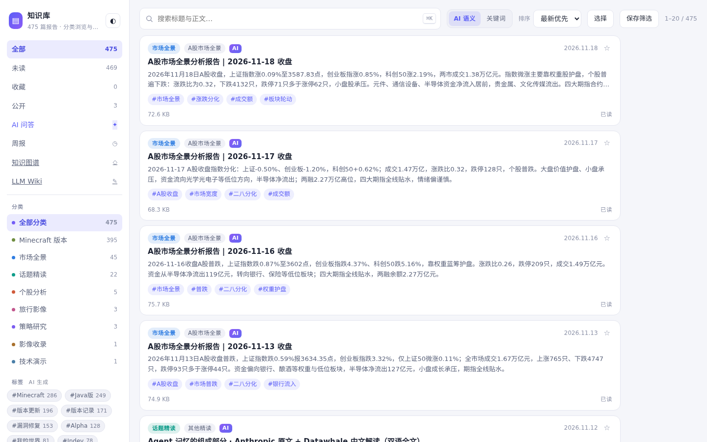

# dsh-kb — knowledge base

**Turn a folder of HTML reports into a local knowledge base that opens from the DSH sidebar — browsable, searchable and askable.**

A DSH plugin that indexes a read-only report library, enriches it with the host's own model, and serves browsing, hybrid search, RAG answers, a knowledge graph and model-written wiki articles.

[](package.json)
[](LICENSE)
[](https://github.com/frankfurtlin/dsh-pocket)

[中文](README.md) · [English](README.en.md)



## What it is

dsh-kb is a DSH plugin made of two halves. The host half adds a permanent sidebar row ("知识库", `order: 15`, right after "Automation tasks") and a main panel that embeds an iframe. The backend is a FastAPI app on `127.0.0.1:8816`; the host reverse-proxies `/kb/*` to it and reuses the DSH login gate, so the plugin itself contains no accounts, passwords, sessions or login page. The backend only listens on loopback.

`reports/` is read-only and is the only source of truth. The only write target is the plugin's own SQLite index (`KB_DATA_DIR/kb.sqlite`): text cache, summaries, read/star state, public markers, AI sidecar output and embeddings. Everything derived can be rebuilt from `reports/`.

A report marked as public also gets an **anonymous read-only link** (`/kb-public/...` on a separate Caddy route), for sharing without a DSH account.

## Design goals

The product statement behind the plugin: *the user only feeds in knowledge, the AI organizes it; the user's only operations are "put it in" and "look it up".* That splits into four verifiable goals:

| # | Goal | Meaning | Status |
|---|---|---|---|
| G1 | Auto classification | Incoming reports land in a sensible category/series; no manual folders or renames | AI-led since v0.4, rules are cold-start and fallback |
| G2 | Auto tagging | Stable, human-readable, filterable topic tags; synonyms merged | AI tags/entities shown and filterable; not yet a full navigation dimension |
| G3 | Relations | Explainable links between reports and topics: related reports, graph, wiki articles | Entity co-occurrence graph + PPR + LLM Wiki articles live |
| G4 | Accurate retrieval | Keyword, semantic and Q&A paths all hit quickly, with measurable quality | Hybrid retrieval live; eval set still small |

Terms used below: **report** = one HTML file under `reports/` (the smallest knowledge unit and the only source of truth); **category** = top-level topic (8 today); **series** = project/version line inside a category (22 groups today); **tag** = free-form term extracted by the model; **entity** = typed noun (company, product, person, metric); **topic node** = graph node aggregating reports that share a tag.

## How a report travels

```
reports/YYYYMMDD/xxx.html
   │ ① scan: title / category / series / date
   ▼
SQLite kb.sqlite ── ② extract summary + full text (≤20,000 chars)
   │ ③ AI enrichment: summary / key points / entities / tags (DSH default model)
   │ ④ embedding: local bge-small-zh (512 dimensions)
   ▼
⑤ organize and retrieve: views / category→series / date / keyword / semantic / ask / digest
   ▼
⑥ output: drawer preview, open original, public link, DSH tools (kb_search/kb_get/kb_ask)
```

| Step | Code |
|---|---|
| Scan, category/series derivation | `server/app/services/kb_index.py` (`scan()` / `classify()` / `_series_for()`) |
| Incremental ingest, text extraction | `server/app/services/kb_store.py` (`sync()` / `_extract_text()`) |
| AI enrichment | `server/app/services/kb_enrich.py` + `kb_ai.py` (through the host bridge `lib/ai-bridge.js`) |
| Embedding and hybrid ranking | `server/app/services/kb_embed.py` + `kb_store.hybrid_search()` |
| Search / ask / digest | `server/app/services/kb_search.py` / `kb_ask.py` / `kb_digest.py` |
| Web UI | `server/app/web/{templates/index.html, static/kb.js, static/style.css}` |

## Features

### Browsing and search

- Left navigation: views (all / unread / starred) → categories → series under the category → dates (last 10 days), plus AI-generated tags (global top 15) and saved filters.
- 8 categories; series are derived from content (stock by "name(code)", topic deep-dives by source, Minecraft by version phase), 22 groups in total. The list is ordered by date or title, 20 per page; cards show category badge, series, date, summary, size, unread state and a star.
- Search hits titles and bodies (SQL `LIKE`, title matches first), highlights matches with `<mark>`, returns a context snippet for body hits, debounces 250 ms, focuses with `⌘K` / `Ctrl+K`, clears or closes the drawer with `Esc`.
- The detail drawer shows category/series, title, date/size/path, the first 1200 characters, and buttons for "open original", star, mark read/unread. Opening a drawer marks the report read.
- Read/star state lives in SQLite (`KB_DATA_DIR/kb.sqlite`) and survives refresh and browser changes.

- Three search modes are visible to the user: smart ranking (default), keyword and semantic exploration. `hybrid` uses **lexical hits as a hard gate** and lets semantics only order those hits; `semantic` is the only mode allowed to recall without a literal match, and it uses a **centred cosine** (corpus mean subtracted) plus a relative threshold `max(0.35, top1×0.85)`.
- Multi-word queries are AND (`铝业 601600`); lexical scoring separates exact-phrase hits (title 1.0 / body 0.55) from token hits.

### AI enrichment (P1–P5)

- Every report gets `summary_ai / key_points / entities / tags` from **the DSH agent's own default model**, through the host's internal AI bridge (`lib/ai-bridge.js`). The backend holds no model API key.
- A background thread fills the backlog (default 3 reports per 120 s, concurrency 2, backoff on rate limits); a CLI can batch it. Cards prefer the AI summary; the drawer shows key points, tags and entities; cards without AI data offer a "generate summary" button.
- Local semantic search: `fastembed` + `BAAI/bge-small-zh-v1.5` (512-dim, model and HF cache under `server/data/`), no online embedding service. Default ranking is `0.62 × cosine + 0.38 × lexical`; a missing model automatically degrades to keyword search.
- RAG answers (`POST /api/kb/ask`): hybrid retrieval top 6, answers grounded only in retrieved passages, with `[n]` citations and related reports. The streaming variant (`/api/kb/ask/stream`, SSE) sends `citations` first (0.3–0.5 s, so sources appear before the answer), then `thinking` progress, `delta` tokens and `done`; if streaming is unavailable it falls back to the one-shot endpoint.
- Weekly digest: last 7 days aggregated by category/tag/series plus 3–6 model-written themes with related reports, cached per day in `server/data/digest.json`.
- DSH tools: the host half registers `kb_search`, `kb_get`, `kb_ask`, so an agent can search, read a report and ask the knowledge base from a conversation (loopback only, no login needed).

### Knowledge graph (P10–P12)

- AI entities are aggregated into graph nodes: entity nodes (`kind=entity`) and topic nodes (`kind=topic`, a tag covering at least `KB_GRAPH_TOPIC_MIN_REPORTS` reports). Node markdown is written to `GRAPH_DIR/pages/<slug>.md` with `index.md` / `log.md` / `SCHEMA.md`, so the directory can be opened as an Obsidian vault. The sidebar "知识图谱" entry opens `/kb/graph/`.
- Tables: `wiki_page` (nodes), `wiki_link` (cross-links), `wiki_source` (which reports contributed), `entity_edges` (co-occurrence edges).
- Compilation is deterministic and free: entities appearing in at least 2 reports become nodes; each node lists an overview, related reports by date, co-occurring entities, tags and sources. Snapshot on 2026-11-19: **474 reports → 284 nodes (231 entities + 53 topics), 3109 references, 1459 cross-links, 1120 co-occurrence edges**.
- Incremental: `reports.content_hash` (sha1) plus each node's `source_hash`; equal hashes skip the write (second compile reports `written=0`). Compilation is triggered after a sync when `KB_GRAPH_AUTO=1`.
- Nodes are embedded too and take part in the same `0.62·cosine + 0.38·lexical` ranking; graph citations in `/api/kb/ask` are labelled `图谱 · <entity type>`.
- Graph queries: `/api/graph/neighbors/{slug}`, `/api/graph/related/{slug}`, `/api/graph/lint` (orphans, broken links, stale nodes, high-frequency tags without nodes).
- **Third recall path (PPR)**: after the semantic+lexical score, take the top 8 reports as seeds, run Personalized PageRank over the report/topic graph (`damping=0.85`, 20 iterations), divide each node's boost by the number of reports it covers, then add `0.15 × boost` to report scores. `KB_HYBRID_WEIGHT_PPR` tunes or disables it; graph failures are silent and never break the main search.
- Graph canvas at `/graph/canvas`: zero-dependency force-directed layout, wheel zoom, drag pan, live filter, click for node details. Data comes from `GET /api/graph/graph?limit=N&min_weight=`.

PPR evaluation (16 queries, gold regex over title+path, 474-report production library):

| Mode | Recall@5 | MRR@10 |
|---|---|---|
| lexical | 0.625 | 0.583 |
| hybrid | 0.812 | 0.627 |
| hybrid + PPR 0.12 | 0.812 | 0.749 |
| **hybrid + PPR 0.15 (default)** | **0.812** | **0.790** |
| hybrid + PPR 0.25 | 0.812 | 0.646 |

Weight 0.15 lifts MRR by 26% over plain hybrid without losing recall; higher weights start to hurt. Per-query ranks and regression cases live in `verification/eval/baseline.json`.

### LLM Wiki (P13)

- A topic or entity with at least `KB_WIKI_MIN_REPORTS` reports is a candidate. The model reads up to 12 most recent sources and writes a Chinese article: 150–250 character overview, 2–5 sections with `[n]` citations, 3–5 takeaways, all sources listed at the bottom with jump-back links.
- Articles are stored in `wiki_article` / `wiki_article_source` and written to `wiki/articles/<slug>.md` plus `wiki/index.md`; the directory can be opened as an Obsidian vault. Every article records its source hash, model and generation time; a changed source marks it `stale` and `/api/wiki/lint` lists it.
- Articles are embedded and participate in the same hybrid ranking, so a search mixes "LLM Wiki" cards with reports; RAG keeps at least one relevant article in the citation pool for synthesis questions.
- Each article page has a timeline of its sources and related articles (shared-source overlap, links below 6 shared sources hidden). H2 headings get anchors and a table of contents when there are at least 2 of them.
- Triggers: background every `KB_WIKI_INTERVAL` (180 s) for one article, "generate one / regenerate" in the page, or `python -m app.cli_wiki --limit N / --slug <slug> --force` for batch runs (used by Hermes after bulk ingests). A failed run is recorded in `wiki_article_job` and retried on the next round.

### Clipping (v0.13)

The toolbar's "剪藏" button accepts pasted text containing one or more URLs, fetches the article, converts it to self-contained HTML and writes it to `reports/YYYYMMDD/clip-<slug>-<sha1-prefix-6>.html` under the "剪藏" category. The report starts with the source URL, site, platform and fetch time.

| Platform | Fetch path | Dependency |
|---|---|---|
| WeChat official accounts | Hermes skill `fetch_wechat.sh` (curl with MicroMessenger UA, body from `#js_content`) | no login; a verification wall is retried once |
| Xiaohongshu (RED) | `fetch_xhs.sh` downloads the post, `ocr_xhs.sh` OCRs the first image | tesseract (chi_sim+eng) |
| Zhihu | needs `ZHIHU_COOKIE` (with `z_c0`); otherwise returns a Chinese hint | anonymous requests hit the `zh-zse-ck` challenge |
| Any other page | trafilatura extraction | `trafilatura` in the project venv |

Implementation notes: the fetch scripts use fixed temp paths, so `kb_clip.py` serializes runs with a module-level lock; a request takes at most 5 links (`MAX_URLS`) and 120 s total; failed entries report their own reason; re-clipping the same URL overwrites the old file (matched by the first 6 chars of the URL's sha1). A report whose HTML contains `<!-- bl:category: X -->` is pinned (`category_pinned=1`) and skipped by the AI classifier, so clipping/blog files keep their category.

### Public links (P6)

- Marking a report public in the drawer produces an anonymous URL `https://hermes.frankfurtlin.top/kb-public/reports/<path>` and copies it. The sidebar "公开" view lists public reports; clicking the green badge again makes it private.
- The anonymous surface only serves: the public report page itself, shared `reports/assets/`, attachments explicitly referenced by that report's HTML/CSS (one `@import/url()` level, max 200), non-HTML siblings in the same directory, and the report's image directories. Everything else is 404. Only GET/HEAD are allowed; writes to `/api/kb/public` still go through the DSH gate.
- Public pages rewrite internal links to `/kb-public/...` and carry `X-Robots-Tag: noindex, nofollow`.
- The public entry lives outside DSH (Caddy on the hermes site), because DSH has a global anonymous gate before routing.

### Operations

- Custom date range (two `date` inputs + apply), matching the old site's `#kb-from` / `#kb-to`; inverted ranges are rejected with a toast.
- Static assets get `?v=<ASSET_VERSION>` (hash of name + mtime + size). Fingerprinted responses are `immutable` for one year; non-fingerprinted ones cache 5 minutes; HTML is `no-cache`. `GZipMiddleware(minimum_size=500)`.
- `GET /healthz` returns `{ok, version, uptime_seconds, reports:{total,unread,starred,public}, ai:{configured}, embed:{enabled,available}}`; an unreadable index returns 503.
- All framework and business errors collapse to `{"ok": false, "error": "..."}`; every response carries `X-Process-Time`, and requests slower than `KB_SLOW_REQUEST_MS` (300 ms) log a `[slow]` warning.
- Batch operations: select up to 500 reports per request (`POST /api/kb/bulk`), dedupe paths, ignore invalid ones and count them as `missing`.
- Search history keeps 8 terms in `localStorage`; saved filters keep 10 named snapshots (query, category, series, date range, view, sort, search mode).

## Install

The backend is a separate systemd service using the plugin's own venv (system Python 3.11 + fastembed/onnxruntime). Secrets go into `server/.env.local` (chmod 600), never into the unit file.

```bash
# 1) venv and dependencies
cd /root/workspace/plugins/dsh-kb
/usr/bin/python3.11 -m venv .venv
.venv/bin/pip install -r server/requirements.txt
```

`/etc/systemd/system/dsh-kb.service`:

```ini
[Unit]
Description=dsh-kb knowledge base backend
After=network.target

[Service]
WorkingDirectory=/root/workspace/plugins/dsh-kb/server
Environment=KB_REPORTS_DIR=/root/workspace/kb-data/reports
Environment=KB_DATA_DIR=/root/workspace/plugins/dsh-kb/server/data
EnvironmentFile=-/root/workspace/plugins/dsh-kb/server/.env.local
ExecStart=/root/workspace/plugins/dsh-kb/.venv/bin/python -m uvicorn app.main:app --host 127.0.0.1 --port 8816
Restart=on-failure
RestartSec=3

[Install]
WantedBy=multi-user.target
```

Mount the plugin with `plugin_manager` (install or hot-mount, then refresh the DSH page; the sidebar row appears after "Automation tasks"):

```
plugin_manager action=install_bundle target=/root/workspace/plugins/dsh-kb
```

The host half proxies to `127.0.0.1:8816` by default. `DSH_KB_UPSTREAM_PORT` points it at another port for testing only.

## Configuration

| Variable | Default | Meaning |
|---|---|---|
| `KB_REPORTS_DIR` | `/root/workspace/kb-data/reports` | Report root (read-only) |
| `KB_DATA_DIR` | `server/data` | Index directory: `kb.sqlite`, `digest.json`, `models/` |
| `KB_AI_URL` | `http://127.0.0.1:3080/kb/_internal/ai` | Internal AI bridge of the host plugin |
| `KB_AI_SECRET_FILE` | `server/.ai-secret` | Shared bridge secret (generated by the host half, 0600; missing = AI off) |
| `KB_AI_TIMEOUT` / `KB_AI_MAX_TOKENS` | `180` / `2000` | Per-call timeout and output cap |
| `KB_AI_AUTO` | `1` | Background AI backfill |
| `KB_AI_BATCH` / `KB_AI_INTERVAL` / `KB_AI_CONCURRENCY` | `3` / `120` / `2` | Reports per round, seconds between rounds, concurrency |
| `KB_AI_MIN_INTERVAL` / `KB_AI_BODY_LIMIT` | `0` / `6000` | Minimum gap between model calls; characters of body sent to the model |
| `KB_CLASSIFY_AUTO` | `1` | Background AI classification |
| `KB_CLASSIFY_BATCH` / `KB_CLASSIFY_INTERVAL` / `KB_CLASSIFY_CONCURRENCY` | `4` / `60` / `2` | Same shape as the AI backfill, for classification |
| `KB_EMBED_ENABLED` | `1` | Local embedding on/off |
| `KB_EMBED_MODEL` | `BAAI/bge-small-zh-v1.5` | fastembed model name |
| `KB_EMBED_MODEL_DIR` / `KB_EMBED_HF_HOME` | `server/data/models` / `server/data/hf-cache` | Model and HF cache directories |
| `KB_EMBED_HF_ENDPOINT` | `https://hf-mirror.com` | Model download endpoint |
| `KB_EMBED_BODY_LIMIT` / `KB_EMBED_BATCH` / `KB_EMBED_INTERVAL` | `2000` / `16` / `2` | Body chars embedded; batch size; seconds between batches |
| `KB_HYBRID_SEMANTIC` / `KB_HYBRID_LEXICAL` | `0.62` / `0.38` | Hybrid ranking weights |
| `KB_HYBRID_WEIGHT_PPR` | `0.15` | PPR boost weight (`0` disables) |
| `KB_SEMANTIC_MIN_SCORE` | `0.35` | Centred-cosine floor for semantic recall |
| `KB_PUBLIC_BASE_URL` | `https://hermes.frankfurtlin.top/kb-public` | Prefix of public links (must match the Caddy route) |
| `KB_GRAPH_DIR` | `<plugin>/graph` | Graph markdown output (can point into an Obsidian vault) |
| `KB_GRAPH_AUTO` | `1` | Incremental graph compile after a sync |
| `KB_GRAPH_MIN_REPORTS` / `KB_GRAPH_MAX_NODES` | `2` / `400` | Minimum reports per entity node; node cap per compile |
| `KB_GRAPH_TOPIC_MIN_REPORTS` | `5` | Reports a tag must cover to become a topic node |
| `KB_WIKI_ARTICLES_DIR` | `<plugin>/wiki` | Wiki markdown output |
| `KB_WIKI_AUTO` | `1` | Background article generation |
| `KB_WIKI_BATCH` / `KB_WIKI_INTERVAL` | `1` / `180` | Articles per round; seconds between rounds |
| `KB_WIKI_MIN_REPORTS` / `KB_WIKI_MAX_SOURCES` | `2` / `12` | Candidate threshold; sources per article |
| `KB_WIKI_SOURCE_CHARS` / `KB_WIKI_MAX_TOKENS` | `900` / `4000` | Source excerpt length; article token cap |

Deleting `KB_DATA_DIR/kb.sqlite` rebuilds the index; read/star state is expected to be lost (back the file up first if it matters).

Public route on the hermes site (`/etc/caddy/Caddyfile`), because DSH gates anonymous requests before routing:

```caddyfile
handle /kb-public {
    redir * /kb-public/ 308
}
handle /kb-public/* {
    header X-Robots-Tag "noindex, nofollow"
    reverse_proxy 127.0.0.1:8816
}
```

Caddy runs with `admin off` on this host, so `systemctl reload caddy` fails; validate with `caddy validate --config /etc/caddy/Caddyfile --adapter caddyfile` and then `systemctl restart caddy` (all sites reconnect briefly).

## Usage

Open the "知识库" row in the DSH sidebar. The panel starts on the report list; type in the search box (`⌘K` / `Ctrl+K`), pick a category, series, tag or date range on the left, and click a title to open the detail drawer. `?` opens the shortcut help, `J`/`K` move the list cursor, `O` or `Enter` opens a report, `S` stars it, `Esc` closes the drawer.

An agent can work with the library directly:

```
kb_search (q: "资金流向", limit: 5)   # hybrid search over reports and graph/wiki nodes
kb_get (path: "20261118/a-share-....html")
kb_ask (question: "这周 A 股资金流向有什么变化？")
```

Background workers and batch jobs (run from `server/`, using the plugin venv):

```bash
../.venv/bin/python -m app.cli_enrich --limit 20            # AI summaries for 20 reports
../.venv/bin/python -m app.cli_classify --limit 20          # AI classification
../.venv/bin/python -m app.cli_wiki --limit 5               # generate LLM Wiki articles
../.venv/bin/python -m app.cli_wiki --slug topic-资金流向 --force
../.venv/bin/python -m app.cli_eval                         # retrieval evaluation
```

The `/api/kb/*` endpoints are also usable directly with `curl` for scripting; writes (state, public, bulk) still go through the DSH auth gate, so use a logged-in session rather than an anonymous request.

## API

All paths below are also mounted under `/kb/*` (e.g. `/kb/api/kb`), because the host forwards `req.url` unchanged; the iframe uses the `/kb/` set. Main endpoints:

| Method | Path | Purpose |
|---|---|---|
| GET | `/api/kb` | List with `q/category/series/tag/date_from/date_to/view/sort/offset/limit/refresh` |
| GET | `/api/kb/tree` | Navigation tree and filter-aware counts, top 15 tags |
| GET | `/api/kb/search?q=&mode=` | `auto\|hybrid\|lexical` search with score/snippet/match |
| POST | `/api/kb/clip` | Body `{text}`: extract URLs and ingest articles |
| GET | `/api/kb/report/{path}` | One report with preview and AI fields; 404 if missing |
| POST | `/api/kb/state` | Body `{path, read?, starred?}` |
| POST | `/api/kb/bulk` | Batch read/star/public (≤500 paths) |
| GET | `/api/kb/ask`… | `POST /api/kb/ask` and SSE `/api/kb/ask/stream` |
| GET | `/api/kb/digest?days=7&refresh=0` | Weekly digest |
| GET/POST | `/api/kb/public` | Public state; mark/unmark a report |
| GET | `/api/kb/ai/stats`, `/api/kb/classify/stats`, `/api/kb/embed/stats` | Progress counters |
| POST | `/api/kb/enrich`, `/api/kb/classify`, `/api/kb/embed` | Manual batch work (≤50 per call for enrich/classify) |
| GET | `/api/graph/nodes`, `/node/{slug}`, `/neighbors/{slug}`, `/related/{slug}`, `/stats`, `/lint`, `/graph` | Graph read API |
| POST | `/api/graph/compile` | Rebuild the graph (deterministic) |
| GET | `/api/wiki/articles`, `/article/{slug}`, `/stats`, `/lint` | Wiki read API |
| POST | `/api/wiki/compile` | Generate/regenerate one or more articles |
| GET | `/graph/`, `/graph/{slug}`, `/graph/canvas`, `/wiki/`, `/wiki/{slug}` | Browsable HTML pages |
| GET | `/reports`, `/reports/{path}` | Report body with rewritten internal links |
| GET | `/kb-public/`, `/kb-public/reports/{path}` | Anonymous public site |
| GET | `/healthz` | Health check |

## Data model

`server/data/kb.sqlite` holds the text cache and the user/AI state. Highlights:

- `reports`: `path` (unique), `size`/`mtime` (incremental key), `title`/`category`/`series`/`date`/`summary`/`body`, `created_at`/`updated_at`, AI fields (`summary_ai`, `key_points`, `entities`, `tags`, `ai_version`, `ai_at`, `ai_model`, `ai_error`), user state (`read`/`read_at`, `starred`/`starred_at`, `public`/`public_at`), embedding (`embedding` float32 BLOB, `embed_model`, `embed_at`), plus classification columns (`category_rule`/`series_rule` vs `category_ai`/`series_ai`, `classify_version`/`classify_at`/`classify_model`/`classify_error`).
- `tags` / `report_tags` / `tag_aliases`: tag master with a redundant report count; many-to-many with a `source` column (currently `ai`, `human` reserved); alias table for synonym merging (not enabled yet). Normalization strips `#`, folds whitespace, drops control characters, caps at 48 characters and dedupes per report.
- `wiki_page` / `wiki_link` / `wiki_source` / `entity_edges` / `compile_job`: graph nodes, cross-links, reverse references, co-occurrence edges and the incremental compile ledger.
- `wiki_article` / `wiki_article_source` / `wiki_article_job`: generated articles, their numbered sources (position = the `[n]` index) and job/retry state.
- `report_events` (append-only): `ingest` / `reclassify` / `ai_enrich` / `ai_error` / `state` / `public` / `remove` / `classify` / `classify_error` rows with payload, model and timestamp, so "why is this report like this now" is answerable.

Design rule: `reports/` is the source, SQLite is derived data plus user state and AI output. Rebuilding restores content and tags; read/star/public timestamps and event history are lost (back up `kb.sqlite` first).

## Verification

```bash
# unit / API tests (temp reports + temp index, production data untouched)
cd /root/workspace/plugins/dsh-kb/server
../.venv/bin/python -m pytest          # 72 passed
../.venv/bin/python -m app.cli_eval    # lexical / hybrid / hybrid+ppr evaluation

# end-to-end
cd /root/workspace/plugins/dsh-kb/verification
node verify-app.mjs      # backend + page (Playwright against http://127.0.0.1:8916)
node verify-proxy.mjs    # host half (lib/index.js) in isolation, no DSH install needed
node verify-dsh.mjs      # inside a real DSH panel (Playwright + launch token)
```

Latest recorded run (2026-11-19, after v0.12 streaming answers): `pytest` **72 passed**; `verify-app.mjs` **132/132**; `verify-proxy.mjs` **11/11**; `verify-dsh.mjs` **34/34**. Screenshots are in `verification/shots/` (see the table in the Chinese README); the page itself works under both `/` and `/kb/`.

Syntax gate: `node --check lib/index.js && node --check client.js && node --check verification/verify-app.mjs && node --check verification/verify-proxy.mjs`; Python: `python3.11 -m py_compile $(find server -name '*.py')`.

## Known limitations

- The sidebar row and main panel depend on the host's `sidebar.panellist` / `main` slots and `ctx.layout.selectPanel(null)` semantics (same as dsh-tavern and dsh-bartending). A host major release that changes the slots requires a matching `client.js` update.
- Real in-DSH click acceptance (sidebar row, panel toolbar, iframe search/drawer) is an install-time step for the operator; `verify-proxy.mjs` covers the host half and `verify-app.mjs` covers the backend and page, but slot registration can only be confirmed inside DSH.
- All AI features (summary, classification, ask, digest, wiki) use DSH's currently selected default model (`agentDefaultModel`). When the model is unavailable or slow, the plugin backs off, records the failure (`ai_error`, wiki job) and keeps working on other reports; `POST /api/kb/enrich {retry_failed:true}` and `python -m app.cli_wiki --force` retry. Quota follows the DSH account; there is no separate third-party key.
- The AI bridge only accepts loopback requests signed with `server/.ai-secret`. If the DSH plugin is not loaded, AI degrades gracefully: ask returns a structured error, the digest becomes a statistics view; browsing, search, read/star are unaffected.
- Local embeddings run on CPU (`bge-small-zh-v1.5`); first load takes about 10 s. A missing model or `KB_EMBED_ENABLED=0` silently degrades to keyword search.
- The `kb_search` / `kb_get` / `kb_ask` tools only appear after the DSH plugin is reloaded; registration lives in `lib/tools.js`.
- The digest window uses report dates (from `YYYYMMDD/` directory names), not generation time; reports in undated directories are excluded from date filters, and reports without AI summaries contribute only titles and counts.
- Classification is AI-led since v0.4: rules are a fallback baseline, AI can change both category and series, and the drawer shows whether a classification is AI or rule-based. The manual-override UI is not built yet (tables and events are in place).
- Tags are filterable since v0.3, but there are no tag pages, synonym merging or manual tag editing yet (remaining G2 work).
- The graph canvas renders the top 200 nodes and the edges between them (`/api/graph/graph?limit=`); bigger graphs are explored through the API and node pages.
- LLM Wiki covers high-frequency topics/entities only: candidates need at least 2 reports, articles use at most 12 sources, and stale articles are marked rather than auto-rewritten until the source hash changes again.
- The retrieval eval set is 16 queries (`verification/eval/queries.json`) — enough to compare modes, not enough for statistical significance across every change.
- Links to missing targets inside a report body keep their original URL and may 404 inside the iframe; that is report content, the plugin does not rewrite it away.
- Public links depend on the Caddy `/kb-public` route matching `KB_PUBLIC_BASE_URL`. Marking is per report with no password or expiry; unpublishing makes old links 404 immediately.
- Clipping needs `ZHIHU_COOKIE` for Zhihu and tesseract for Xiaohongshu OCR; fetch scripts use fixed temp paths, so clipping is serialized and cannot run in parallel.

## Directory layout

```
package.json                 plugin manifest (dsh.bundle.patch / dsh.client.platform=web)
cordis.patch.yml             bundle patch: insert id=dsh-kb
lib/index.js                 host half: /kb reverse proxy + DSH auth gate + /kb → /kb/ redirect
lib/tools.js                 DSH tools: kb_search / kb_get / kb_ask
lib/ai-bridge.js             internal AI bridge to the DSH default model, streaming variant
client.js                    client half: sidebar row + main panel (toolbar + iframe)
server/
  app/main.py                FastAPI composition root (routes mounted under both / and /kb/)
  app/config.py              paths and AI/embedding config (all KB_* / AI_* / EMBED_* variables)
  app/services/              index/store/enrich/embed/search/ask/digest/classify/graph/wiki/public
  app/api/routes/            pages, kb, reports, graph, wiki, public_site
  app/web/                   templates/index.html, static/{style.css,kb.js,core.js,ui.js}, icon
  app/cli_*.py               enrich / classify / wiki / eval / import helpers for cron and Hermes
  tests/                     pytest: index, search, state, batch, public site, graph, wiki, canvas (72 tests)
  data/                      kb.sqlite, digest.json, models/, hf-cache/ (the only write target)
  requirements.txt           fastapi / uvicorn / jinja2 / httpx / numpy / fastembed / onnxruntime
graph/                       compiled graph markdown: pages/<slug>.md + index/log/SCHEMA
wiki/                        compiled article markdown: articles/<slug>.md + index.md
verification/                verify-app.mjs, verify-proxy.mjs, verify-dsh.mjs, shots/, eval/
docs/                        GRAPH-WIKI.md, PRODUCT-REVIEW.md, review-shots/
scripts/                     fetch-neural-media.sh and maintenance helpers
```

## License and third-party assets

The code is MIT (see [LICENSE](LICENSE)). The jellyfish/orb media under `server/app/web/static/media/` was copied from `betterlife/app/domains/neural/public/media/` (neural-creator-dashboard by luoluo-121). That project has used **PolyForm Noncommercial 1.0.0** since 0.2.0 (0.1.0 was MIT), so those files are excluded from the repository (`.gitignore`) and are for local, non-commercial use only. Re-fetch with `./scripts/fetch-neural-media.sh`.
