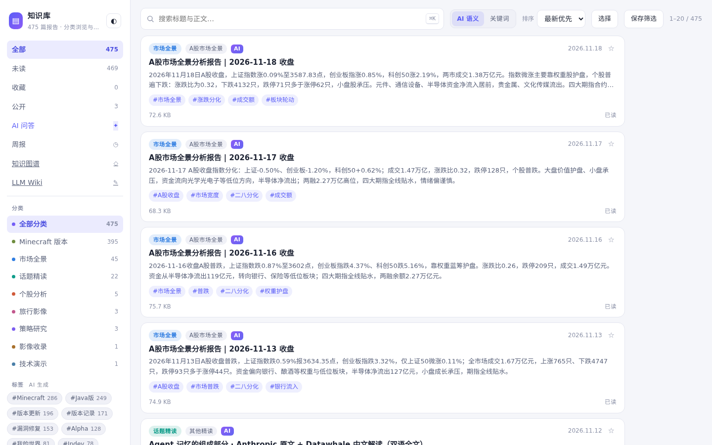

# dsh-kb

**English** · [简体中文](README.zh-CN.md)

[](package.json)
[](LICENSE)
[](https://github.com/frankfurtlin/dsh-pocket)

A local knowledge base for DSH. Point it at a folder of HTML reports and get browsing, hybrid search, cited answers, a knowledge graph and model-written wiki articles in the sidebar.



## The problem

My report folder keeps growing: a few hundred HTML files on A-share wrap-ups, Minecraft versions, topic deep-dives and travel notes. Files are not a library. I cannot search across the bodies, I cannot ask "what changed in fund flows this week", and I cannot tell which reports I already read. They come from a dozen different sources, with no common search across them.

## Quick example

The agent can work with the library from a conversation:

```text
> 这周 A 股资金流向有什么变化？

kb_search(q: "资金流向", limit: 3)        # hybrid: literal hits first, semantics orders them
→ 20261118/a-share-….html    两市成交 1.38 万亿元…
→ 20261116/a-share-….html    资金从半导体净流出 119 亿元…
→ topic-资金流向 (graph node)

kb_ask(question: "这周资金流向有什么变化？")
→ 资金偏向银行、保险等低位板块，半导体连续净流出 [1][2]
  引用：[1] 11-18 收评 · [2] 11-16 收评
```

The output above is abridged. Search returned the two wrap-ups plus a graph node, and the answer says money rotated into banks and insurers, citing both reports. The real answer streams citations first, then tokens, and each `[n]` links back to the report it came from. The same data is in the sidebar panel: search box, category and series navigation, tag filters, a detail drawer with the AI summary and a button to open the original.

## How it works

```text
reports/YYYYMMDD/xxx.html
   │ ① scan: title / category / series / date
   ▼
SQLite kb.sqlite  ── ② cache summary + full text (≤20,000 characters)
   │ ③ AI enrichment: summary / key points / entities / tags (host model)
   │ ④ embedding: local bge-small-zh, 512 dimensions
   ▼
⑤ organize and retrieve: views / category → series / date / keyword / semantic / ask / digest
   ▼
⑥ output: drawer preview, original file, public link, DSH tools
```

Since v1.0 the source of truth is the index plus the private blob store: file-backed reports under `reports/` are indexed, and everything ingested (daily reports, digest, clips, uploads) exists only as `reports` rows plus blobs. Derived data — text cache, summaries, tags, embeddings, graph nodes, wiki articles — is rebuilt from the index; the file-backed subset can be rebuilt from `reports/`. The single write target is `KB_DATA_DIR/kb.sqlite`.

## Install

The backend is a separate service on loopback, with its own venv (Python 3.11; fastembed and onnxruntime are the heavy part). The host half is a thin reverse proxy and a sidebar row.

The examples below install the checkout at `/opt/dsh/dsh-kb`. That is a convention,
not a requirement: use your own checkout and substitute it in the commands and in
the unit file.

```sh
sudo git clone https://github.com/frankfurtlin/dsh-kb /opt/dsh/dsh-kb
cd /opt/dsh/dsh-kb

# 1) venv and dependencies
/usr/bin/python3.11 -m venv .venv
.venv/bin/pip install -r server/requirements.txt
```

The backend unit ships with the repo, so there is nothing to copy by hand:

```sh
sudo cp deploy/systemd/dsh-kb.service.example /etc/systemd/system/dsh-kb.service
#   not cloned to /opt/dsh/dsh-kb? change the three paths in the copied file
sudo systemctl daemon-reload
sudo systemctl enable --now dsh-kb
curl -s http://127.0.0.1:8816/healthz
```

The header of `deploy/systemd/dsh-kb.service.example` lists what must change (the
checkout path appears in `WorkingDirectory`, `EnvironmentFile` and `ExecStart`),
what may change (`KB_DATA_DIR` / `KB_REPORTS_DIR` relocate the index and the scan
root; both default to `<checkout>/server/data`, so an external report folder is no
longer needed), and why `User=root` is only a starting point. `deploy/systemd/README.md`
carries the same steps plus the notes for running as a dedicated user.

Put secrets in `server/.env.local` (chmod 600), never in the unit file; the AI bridge secret is generated by the host half. Then mount the plugin and refresh the DSH page:

```
plugin_manager action=install_bundle target=<path-to-your-checkout>
# or from a shell: dsh plugin --profile web add <path-to-your-checkout>
```

The "知识库" row appears in the sidebar after "Automation tasks". The host proxies `/kb/*` to `127.0.0.1:8816`; `DSH_KB_UPSTREAM_PORT` moves that target for testing. There is no login code in the plugin: every request goes through the DSH reverse-proxy gate, and the backend listens on loopback only.

## Usage

Open the panel from the sidebar. It starts on the report list; `⌘K` / `Ctrl+K` focuses the search box, `J` / `K` move the list cursor, `O` or `Enter` opens a report, `S` stars it, `Esc` closes the drawer, and `?` shows the shortcut help. Read and star state is stored in the index, so it survives a refresh or a different browser.

New in v1.0: the **投喂** (ingest) button accepts files or pasted text/links — HTML, Markdown, TXT, PDF, Word, Excel, PPT, images, audio and video. Text is extracted in-process; audio and video are transcribed locally with SenseVoice and the transcript becomes searchable body text. Ingested documents are rows in the index (no file under `reports/`). Files over 10 MB are encrypted with AES-256-GCM and stored in COS; smaller ones live in a content-addressed local blob store and are mirrored to COS encrypted.

Batch work runs from the server directory, using the plugin venv:

```sh
../.venv/bin/python -m app.cli_enrich --limit 20     # AI summaries for 20 reports
../.venv/bin/python -m app.cli_classify --limit 20   # AI classification
../.venv/bin/python -m app.cli_wiki --limit 5        # LLM Wiki articles
../.venv/bin/python -m app.cli_eval                  # retrieval evaluation
```

Everything the UI does is also a JSON endpoint, and the page itself uses the `/kb/`-mounted set. Two probes while the backend is up:

```sh
curl -s 'http://127.0.0.1:8816/api/kb/search?q=资金流向&mode=auto&limit=3'
curl -s -X POST http://127.0.0.1:8816/api/kb/ask -H 'Content-Type: application/json' \
  -d '{"question":"这周资金流向有什么变化？"}'
```

The direct port is loopback-only. Through the host half every request passes the DSH login gate first, and writes (read/star/public) are meant to go that way.

## Configuration

The backend reads environment variables. Paths are relative to `server/` when not absolute.

| Variable | Default | Meaning |
|---|---|---|
| `KB_REPORTS_DIR` | `<checkout>/server/data/reports` | Report scan root; read-only |
| `KB_DATA_DIR` | `server/data` | Index directory: `kb.sqlite`, `digest.json`, `models/` |
| `KB_AI_URL` / `KB_AI_SECRET_FILE` | `http://127.0.0.1:3080/kb/_internal/ai` / `server/.ai-secret` | Host AI bridge and its shared secret (missing = AI off) |
| `KB_AI_TIMEOUT` / `KB_AI_MAX_TOKENS` | `180` / `2000` | Per-call timeout and output cap |
| `KB_AI_AUTO` / `KB_AI_BATCH` / `KB_AI_INTERVAL` / `KB_AI_CONCURRENCY` | `1` / `3` / `120` / `2` | Background summary backfill: on/off, reports per round, seconds between rounds, concurrency |
| `KB_AI_MIN_INTERVAL` / `KB_AI_BODY_LIMIT` | `0` / `6000` | Minimum gap between model calls; body characters sent to the model |
| `KB_CLASSIFY_AUTO` / `KB_CLASSIFY_BATCH` / `KB_CLASSIFY_INTERVAL` / `KB_CLASSIFY_CONCURRENCY` | `1` / `4` / `60` / `2` | The same shape, for AI classification |
| `KB_EMBED_ENABLED` / `KB_EMBED_MODEL` | `1` / `BAAI/bge-small-zh-v1.5` | Local embeddings and model name |
| `KB_EMBED_MODEL_DIR` / `KB_EMBED_HF_HOME` / `KB_EMBED_HF_ENDPOINT` | `server/data/models` / `server/data/hf-cache` / `https://hf-mirror.com` | Model cache and download endpoint |
| `KB_EMBED_BODY_LIMIT` / `KB_EMBED_BATCH` / `KB_EMBED_INTERVAL` | `2000` / `16` / `2` | Body characters embedded, batch size, seconds between batches |
| `KB_HYBRID_SEMANTIC` / `KB_HYBRID_LEXICAL` | `0.62` / `0.38` | Hybrid ranking weights |
| `KB_HYBRID_WEIGHT_PPR` | `0.15` | Graph boost weight; `0` disables the third recall path |
| `KB_SEMANTIC_MIN_SCORE` | `0.35` | Centred-cosine floor for semantic recall |
| `KB_PUBLIC_BASE_URL` | `https://hermes.frankfurtlin.top/kb-public` | Prefix of public links; must match the Caddy route |
| `KB_GRAPH_DIR` / `KB_GRAPH_AUTO` | `<plugin>/graph` / `1` | Graph markdown output; incremental compile after a sync |
| `KB_GRAPH_MIN_REPORTS` / `KB_GRAPH_MAX_NODES` / `KB_GRAPH_TOPIC_MIN_REPORTS` | `2` / `400` / `5` | Reports per entity node, node cap per compile, reports a tag needs to become a topic |
| `KB_WIKI_ARTICLES_DIR` / `KB_WIKI_AUTO` | `<plugin>/wiki` / `1` | Wiki output and background article generation |
| `KB_WIKI_BATCH` / `KB_WIKI_INTERVAL` / `KB_WIKI_MIN_REPORTS` / `KB_WIKI_MAX_SOURCES` | `1` / `180` / `2` / `12` | Articles per round, seconds between rounds, candidate threshold, sources per article |
| `KB_WIKI_SOURCE_CHARS` / `KB_WIKI_MAX_TOKENS` | `900` / `4000` | Source excerpt length and article token cap |

Public links also need a `/kb-public` reverse-proxy route in Caddy; the exact block is in the Chinese README, in 公开外链部署.

## What it does

**Browsing and search.** Reports are listed by view (all / unread / starred / public), category (8 today), series (22 groups) and date, plus model-generated tags. Series are derived from content, not from folders, so a stock report groups under its name and code. Search has three modes: smart ranking (the default), keyword, and semantic exploration. Smart ranking treats lexical hits as a hard gate and lets semantics only order them — a query will not drift to a plausible page that does not contain the words. Titles and bodies are searched, matches are highlighted, and body hits come with a snippet.

**AI enrichment and cited answers.** The DSH host's default model writes each report's summary, key points, entities and tags through an internal bridge; the backend stores no model key. A background thread works through the backlog while browsing stays responsive. Local `bge-small-zh` embeddings (512 dimensions, CPU) add semantic recall, and a missing model silently degrades to keyword search. `kb_ask` answers only from the top six retrieved passages, with `[n]` citations; the SSE variant sends citations first so the sources are visible before the answer text arrives.

**Graph and wiki.** Entities and frequent tags become graph nodes with co-occurrence edges, written as markdown under `graph/` so the directory opens as an Obsidian vault. A third recall path runs personalized PageRank over that graph and adds a small boost to report scores. On the recorded evaluation it lifted MRR@10 from 0.63 to 0.79 at unchanged recall. The LLM Wiki takes a frequent topic, reads its most recent sources and writes a cited article into `wiki/`; articles are embedded too, so search results and answers mix them with reports.

**Clipping, public links, agent tools.** Paste WeChat, Xiaohongshu, Zhihu or plain web links into the toolbar and each one becomes a self-contained HTML report with its source URL, site and fetch time. A public marker turns a report into an anonymous read-only URL under `/kb-public/...` that needs no DSH account. Agents get `kb_search`, `kb_get` and `kb_ask` over loopback.

**Operations.** Bulk read/star/public for up to 500 reports, saved filters, `GET /healthz`, a slow-request log, and one JSON error shape for every failure.

**Data and storage.** `reports/` (`server/data/reports/`) is now an empty directory, kept only as the scan root and path boundary: all reports, images, CSS and data files (326 assets) live in the content-addressed encrypted store and are served back at their original paths. Deleting `kb.sqlite` restores the file-backed reports and their tags, but **v1.0 ingested documents and their blobs live only in the index** (`reports.uid` rows plus `data/blobs/` and the encrypted COS mirror), so back up the sqlite file, the blob directory and the blob key (`KB_BLOB_KEY_FILE`, by default `~/.secrets/kb-blob.key`) before rebuilding. `report_events` keeps an append-only trail: ingest, reclassify, AI enrichment, state changes, public marks and failures. That is how "why is this report like this now" gets answered.

## What it doesn't do

- It is not multi-user. One index per install: read, star and public state are global, identities come from the DSH login, and there are no per-user views.
- It is not a crawler. It indexes what you feed it — file reports under `reports/`, clips and uploads — but does not walk feeds.
- It is not bilingual. Content, categories, prompts and the UI are Chinese, and the model answers in Chinese.
- It does not stand alone. AI features need the host half; with it down, `ask` returns a structured error and the digest becomes a statistics view, while browsing and search keep working.
- It is not exhaustive. The graph canvas renders the top 200 nodes, and the retrieval evaluation is 16 queries — enough to compare modes, not to prove a change.
- It does not finish the organization for you. Classification is AI-led with rules as fallback and there is no manual override UI; tags are filterable but have no tag pages, synonym merge or editing. Public links have no password and no expiry.

## Docs

The Chinese README is the deep reference — [README.zh-CN.md](README.zh-CN.md) — and is much longer than this file. Useful sections:

- **设计目标 / 产品北极星** and **能力（M1–P14）**: why the plugin exists and what each milestone added.
- **一篇报告从「投喂」到「被查出来」**: the scan → enrich → embed → retrieve pipeline, with the code file for each step.
- **API** and **数据模型**: every endpoint, and the SQLite schema including the append-only event log.
- **知识图谱** and **LLM Wiki**: graph compilation, the PPR evaluation table, wiki article generation and staleness.
- **剪藏** and **公开外链部署**: platform-specific fetch paths, and the Caddy block for anonymous links.
- **验收** and **已知限制 / 风险**: the recorded test runs and the remaining risks in the author's own words.

Longer design notes live in [docs/GRAPH-WIKI.md](docs/GRAPH-WIKI.md) and [docs/PRODUCT-REVIEW.md](docs/PRODUCT-REVIEW.md).

## Verify

```sh
# unit and API tests (temporary reports and index; production data untouched)
cd server && ../.venv/bin/python -m pytest        # 72 passed

# retrieval evaluation: lexical / hybrid / hybrid + PPR
../.venv/bin/python -m app.cli_eval

# end to end
cd ../verification
node verify-app.mjs      # backend + page (Playwright against 127.0.0.1:8916)
node verify-proxy.mjs    # host half in isolation, no DSH install needed
node verify-dsh.mjs      # inside a real DSH panel (Playwright + launch token)
```

Last recorded run, 2026-11-19: `pytest` 72 passed, `verify-app` 132/132, `verify-proxy` 11/11, `verify-dsh` 34/34. Screenshots are in `verification/shots/`.

## Contributing

Run the tests before sending a patch: `../.venv/bin/python -m pytest` in `server/` (72 tests), plus `node verification/verify-app.mjs` for the page and `node verification/verify-proxy.mjs` for the host half. Add a test for a behavior change, keep one change per commit, and use Conventional Commits.

## License

MIT — see [LICENSE](LICENSE). One asset exception: the jellyfish/orb media under `server/app/web/static/media/` came from a project that moved to PolyForm Noncommercial 1.0.0, so those files are gitignored and for local, non-commercial use only; `scripts/fetch-neural-media.sh` fetches them again.
