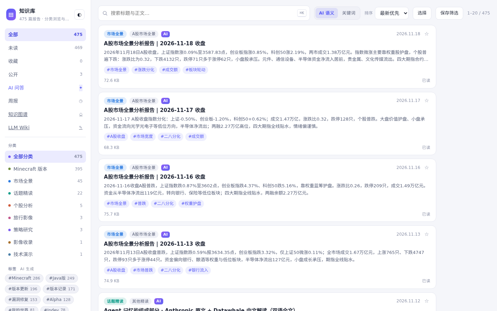

<div align="center">

# dsh-kb 「知识库」

**把报告、剪藏和投喂的内容变成可浏览、可检索、可问答的本地知识库，DSH 侧栏点开即用。**

[](package.json)
[](LICENSE)

[English](README.md) · **简体中文**

</div>



> 架构总览（写入 → 摄取 → 存储 → 读取 → 出口）：[docs/ARCHITECTURE.html](docs/ARCHITECTURE.html)

## 这是什么

dsh-kb 是 DSH 的知识库插件：侧栏常驻「知识库」一行，主面板内嵌 FastAPI 页面，宿主把 `/kb/*` 反代到本机 8816 并复用 DSH 登录鉴权。v1.0 起主存储是**索引库 + 私有 blob**（DB-first）：每日报告、周度推送、剪藏和手动投喂都不再写文件，`reports/`（`server/data/reports/`）现在是空目录（只作扫描根与路径校验边界）：报告、图片、CSS 等 326 个附件全部在内容寻址存储里（加密 blob，按原路径输出）。插件唯一的写入口是自己的 SQLite 索引（摘要、已读/收藏、公开标记、AI 产物、向量、blob 台账）。AI 摘要、分类与问答都走 DSH 默认模型，插件不持有模型密钥。

## 功能

- **浏览与检索**：视图 / 分类 / 系列 / 时间 / 标签导航，词法 + 本地 bge-small-zh 向量混合检索（0.62 / 0.38），三种模式可切。
- **AI 增强**：每篇报告抽摘要、要点、实体、标签，后台增量补全，不另外维护模型 key。
- **问答与周报**：RAG 问答带 `[n]` 引用，支持 SSE 流式；最近 7 天的主题周报。
- **知识图谱**：实体/主题节点 + 共现边 + PPR 第三路召回，带可视化画布。
- **LLM Wiki**：按高频主题生成带引用的长文，参与检索与问答。
- **公开外链**：单篇标记公开后，匿名只读 `/kb-public/...`，不需要 DSH 账号。
- **剪藏**：微信 / 小红书 / 知乎 / 普通网页链接粘贴入库（v0.13）。
- **投喂（v1.0，DB-first）**：面板「投喂」可上传文件或粘贴文本/链接——HTML / MD / TXT / PDF / Word / Excel / PPT / 图片 / 音视频都行。正文抽取后直接入库，**不写 `reports/`**；Word/Excel/PPT 用 LibreOffice 转 PDF 再取首屏做缩略图；音视频用本地 SenseVoice 转写成正文并进检索；>10MB 的文件加密（AES-256-GCM）后主存 COS，小文件走本地内容寻址存储并后台加密镜像到 COS。
- **DSH 工具**：`kb_search` / `kb_get` / `kb_ask`，agent 在对话里直接检索与提问。

## 安装

本文的示例把 checkout 装在 `/opt/dsh/dsh-kb`；这只是示例路径，换成你自己的目录，命令里的
路径与单元文件里的路径要一起改。

```bash
sudo git clone https://github.com/frankfurtlin/dsh-kb /opt/dsh/dsh-kb
cd /opt/dsh/dsh-kb

# 后端（独立 systemd 服务、插件内 venv）
/usr/bin/python3.11 -m venv .venv
.venv/bin/pip install -r server/requirements.txt

sudo cp deploy/systemd/dsh-kb.service.example /etc/systemd/system/dsh-kb.service
sudo systemctl daemon-reload && sudo systemctl enable --now dsh-kb
curl -s http://127.0.0.1:8816/healthz

# DSH 侧挂载：dsh plugin --profile web add <你的 checkout 路径>
#              等价：plugin_manager action=install_bundle target=<你的 checkout 路径>
```

## 详细文档


把 betterlife 老站的**报告库**拆成独立 DSH 插件：侧栏常驻行「知识库」（`order: 15`，
排在「Automation tasks」之后），主面板内嵌同源 iframe。宿主半把 `/kb/*` 反代到本机
`127.0.0.1:8816` 的 FastAPI；后端读 `reports/` 与索引库，唯一的写入点是自己的
SQLite 索引库（摘要/正文缓存 + 已读/收藏 + 公开标记 + AI sidecar + 向量）。

另有一条**匿名只读外链**（P6）：作者把某篇报告标记为「公开」后，别人不需要 DSH 账号，
就能通过 `https://hermes.frankfurtlin.top/kb-public/...` 打开这篇报告与它引用的附件。

**没有登录/认证代码**：插件不带账号、密码、session、cookie、登录页；鉴权完全交给 DSH
宿主的反代闸门（每个请求先过 `connection.requestRejection()`），后端只监听 `127.0.0.1`。

## 设计目标（产品北极星）

> 「知识库就是一个存放知识的，我给你各种各样的知识，你帮我按照合理的、优雅的、准确的分类，
> 并构建一些知识的 tag 分类之类的，同时后续也可以构建知识图谱、LLM wiki 等关联性，
> 我查询搜索的时候也能方便快捷准确地检索出来。」—— 用户对该插件的定位（2026-11-13）

一句话：**用户只负责投喂知识，AI 负责组织；用户的全部操作只有「放进来」和「查出来」。**

由此拆成四个可验收的目标：

| # | 目标 | 含义 | 现状 |
|---|---|---|---|
| G1 | 自动分类 | 报告进来就归到合理的分类/系列，不需要人工建文件夹、改名 | **AI 主导已上线（v0.4）**：规则只做冷启动与兜底 |
| G2 | 自动标签 | 每篇有稳定、人可读、可筛选、可聚合的主题标签；同义标签自动合并 | AI 已生成 tags/entities 并展示，但还不是导航维度 |
| G3 | 关联 | 报告之间、主题之间有可解释的关系（相关报告 / 知识图谱 / LLM Wiki 文章） | 图谱节点 + 共现边 + PPR（P11）；LLM Wiki 文章（P13）已上线 |
| G4 | 准确检索 | 关键词、语义、问答三条路都能快速命中，且质量可度量 | 混合检索已上线，但还没有评测集 |

**术语**（README 其余部分沿用）：

- **报告**：索引库里的一行文档（v1.0 起），或 `reports/` 下的一篇文件型 HTML（只剩公开页）；两者都能在列表里打开。
- **分类**：一级主题（当前 8 类）；**系列**：分类下的项目/版本线（当前 22 组）。
- **标签**：AI 从正文抽出的自由词（如 `#A股收盘`、`#半导体`），跨分类可复用。
- **实体**：结构化名词（公司、产品、人物、指标），带类型，是未来图谱的节点。
- **主题节点**（P11 已上线）：把同一标签下的报告聚成一个主题节点图节点；**LLM Wiki 文章**（模型撰写、带引用，P12 起独立成层）已在 P13 上线。

### 演进路线（按依赖顺序）

- **R1 AI 分类（已完成，v0.4）**：独立分类器用「标题 + 日期 + 规则分类 + 标签 + AI 摘要」
  选分类与系列（限定枚举内），写入 `category_ai` / `series_ai` 并切换生效值；规则列
  `category_rule` / `series_rule` 保留为兜底与对照。分类优先级「人工覆盖 > AI > 规则」中，
  人工覆盖入口尚未做（表与事件已就绪）。验收：全量分类 + 抽样人工复核。
- **R2 标签一等公民**（G2）：标签规范化（单复数、别名、中英同义合并）、标签页（点标签看
  该标签下所有报告）、标签作为筛选维度与检索加权；验收：标签覆盖率 ≥ 95%，只出现一次的
  碎片标签占比 ≤ 30%。
- **R3 关系与图谱**（G3，已完成 v0.5/v0.6）：实体共现边 + 主题节点 + 邻域/相关报告 API +
  PPR 第三路召回；验收有 16 条 query 的 Recall@5 / MRR 评测。
- **R3+ 图谱可视化**（G3，待做）：把节点/边渲染成可交互画布（当前是索引页 + 节点页）。
- **R4 LLM Wiki 文章**（G3，P12 起与图谱拆开；P13 已上线）：按高频主题/实体生成模型撰写的文章（综述 + 关键结论 + [n] 引用），
  支持增量更新；验收：每个高频标签都有可读主题页。
- **R5 检索质量回归**（G4，部分完成）：已建 16 条「query → 期望报告」评测集
  （`verification/eval/queries.json`）与 `cli_eval` 指标输出；扩充到 50–100 条并纳入 CI 回归。

### 设计原则

1. **文件型报告是派生物，DB 文档不是**：文件型的分类、标签、关系、向量可以从 `reports/` 重建；v1.0 投喂的文档只存在于索引库与私有 blob，必须一起备份（见「备份」）。不产生「只存在于
   索引里、丢了就找不回」的知识。
2. **可解释、可覆盖**：每条 AI 结论保留来源（模型、时间、原文片段），允许人工覆盖且覆盖优先。
3. **增量优先、成本可控**：新报告只跑增量；全量重算由显式命令触发（`refresh` / CLI），
   不在用户查询路径上调用模型。

## 一篇报告从「投喂」到「被查出来」

```
reports/YYYYMMDD/xxx.html
   │ ① 扫描：标题 / 分类 / 系列 / 日期
   ▼
SQLite kb.sqlite ── ② 正文摘要 + 全文（≤2 万字）
   │ ③ AI 增强：摘要 / 要点 / 实体 / 标签（DSH 默认模型）
   │ ④ 向量化：本地 bge-small-zh（512 维）
   ▼
⑤ 组织与检索：视图 / 分类→系列 / 时间 / 关键词 / 语义 / 问答 / 周报
   ▼
⑥ 输出：抽屉预览、打开原文、公开外链、DSH 工具（kb_search/kb_get/kb_ask）
```

| 步骤 | 代码位置 |
|---|---|
| 扫描与分类/系列派生 | `server/app/services/kb_index.py`（`scan()` / `classify()` / `_series_for()`） |
| 增量入库与正文抽取 | `server/app/services/kb_store.py`（`sync()` / `_extract_text()`） |
| AI 增强 | `server/app/services/kb_enrich.py` + `kb_ai.py`（经 `lib/ai-bridge.js` 走 DSH 模型） |
| 向量化与混合排序 | `server/app/services/kb_embed.py` + `kb_store.hybrid_search()` |
| 检索 / 问答 / 周报 | `server/app/services/kb_search.py` / `kb_ask.py` / `kb_digest.py` |
| 前端 | `server/app/web/{templates/index.html, static/kb.js, static/style.css}` |

## 能力（M1 + M2 + AI P1–P5 + P6 公开 + P7 操作效率 + P8 数据模型 + P9 AI 分类 + P10–P12 图谱 + P13 LLM Wiki + P14 体验优化）

**信息架构**
- 左导航：视图（全部 / 未读 / 收藏）→ 分类 → 分类下的系列 → 时间（最近 10 个日期）。
- 分类 8 个；系列按内容派生：个股按「名称(代码)」、话题精读按来源（小红书/公众号/YC/
  AIRP）、Minecraft 按版本阶段（Infdev/Indev/Alpha/Beta/快照/Classic 0.x/1.x 正式版/
  26.x 新版等），共 22 组。
- 列表按日期倒序（或标题/最早/最近更新），20 条一页；卡片显示分类徽章、系列、日期、
  摘要、大小、未读状态，可 star；未读卡片带左侧强调条。

**检索与消费闭环**
- 搜索框同时搜标题与正文（后端 LIKE，标题命中优先），结果高亮 `<mark>`；正文命中返回
  上下文片段；250ms 防抖，`⌘K`/`Ctrl+K` 聚焦，`Esc` 清空或关抽屉。
- 点标题打开右侧**详情抽屉**：分类/系列、标题、日期/大小/路径、正文前 1200 字摘要、
  「打开原文 ↗」「收藏」「标记为未读/已读」；打开抽屉自动标记已读。
- 已读/收藏落在后端 SQLite（`KB_DATA_DIR/kb.sqlite`），刷新/换浏览器不丢；收藏与未读
  视图计数实时联动。

**数据侧**
- 启动时建/增量同步索引：新增/变化（size/mtime 或分类/系列等元数据漂移）才重读正文，
  消失的报告从索引删除；`重新扫描` 按钮强制 refresh。
- 摘要取的正文前 3 个 ≥40 字的 `<p>`，全文去标签后截 20000 字；正文里的 `/mine/*` 与
  根绝对路径在返回时改写成 `/kb/*`。

**AI 知识库（P1–P5）**
- **P1 sidecar**：每篇报告由 **DSH 自己的模型**（`dsh-agent` 默认模型，经宿主
  `lib/ai-bridge.js` 的内部 AI 桥）抽取 `summary_ai / key_points / entities / tags`，写回
  索引库；后端不持有任何模型 API key。卡片优先显示 AI 摘要，抽屉显示
  要点/标签/实体，缺 AI 的卡片有「生成 AI 摘要」按钮。后台线程分批补全（默认 3 篇 / 120s，
  并发 2，模型限流时自动退避），也可用 CLI 批量跑。
- **P2 语义检索**：本地 `fastembed` + `BAAI/bge-small-zh-v1.5`（512 维，模型在
  `server/data/models`，不依赖在线 embedding）给每篇建向量；搜索默认混合排序
  `0.62·余弦 + 0.38·词法`，工具栏可切「AI 语义 / 关键词」，模型缺席时自动降级关键词。
- **P3 RAG 问答**：侧栏「AI 问答」→ 混合检索 top6 → 只依据检索片段作答，答案带 `[n]`
  引用与相关报告；后端 `POST /api/kb/ask`。
- **P4 DSH 工具**：host 半注册 `kb_search` / `kb_get` / `kb_ask` 三个工具，agent 在对话里
  可直接检索、读报告、问知识库（走本机 8816，不需要登录）。
- **P5 周报**：侧栏「周报」→ 最近 7 天的分类/标签/系列聚合 + 模型主题归纳（3-6 个主题，
  每个带相关报告），结果按天缓存在 `server/data/digest.json`。
- **P6 公开外链**：抽屉里点「公开」→ 生成匿名可访问的
  `https://hermes.frankfurtlin.top/kb-public/reports/<path>` 并复制链接；侧栏「公开」视图
  集中列出已公开报告，卡片带绿色「公开」徽标，再次点击即可取消。
  - 匿名端只放行：已公开报告页本身 + `reports/assets/` 共享资源 + 该报告 HTML/CSS 显式引用
    的附件（css 追一层 `@import/url()`，上限 200）+ 同目录非 HTML 兄弟文件 +
    `<报告目录>/images/<报告名>/` 与 `<报告目录>/<报告名>/` 图片目录；其余一律 404。
  - 只允许 GET/HEAD；写接口 `/api/kb/public` 仍只经 DSH 反代（要登录）。
  - 公开页内链统一改写成 `/kb-public/...`，并带 `X-Robots-Tag: noindex, nofollow`。
  - 外链入口在 DSH 之外（hermes 站点 Caddy），因为 DSH 在路由分发前有全局匿名闸门。

**知识图谱（P10 / P11 / P12）**
- 报告里的 AI 实体（P1 抽取）被聚合成**节点**：实体节点（`kind=entity`）与主题节点
  （`kind=topic`，标签覆盖 ≥`KB_GRAPH_TOPIC_MIN_REPORTS` 篇报告）。节点 markdown 写到
  `GRAPH_DIR/pages/<slug>.md`，另有 `index.md`/`log.md`/`SCHEMA.md`，可整目录丢进 Obsidian；
  侧栏「**知识图谱**」直接打开（`/kb/graph/`）。
- 表：`wiki_page`（节点：slug/正文/来源 hash/状态）、`wiki_link`（互链）、`wiki_source`
  （反向引用：哪篇报告贡献了这节点）、`entity_edges`（共现边）。
- 编译是**确定性**的（不调模型、零成本）：实体按出现篇数建节点（默认 ≥2 篇），每节点含概述、
  相关报告（按日期）、共现实体、标签、来源。当前 474 篇 → **284 节点 = 231 实体 + 53 主题 /
  3109 引用 / 1459 互链 / 1120 条共现边**。
- 增量：`reports.content_hash`（sha1）+ 节点的 `source_hash`，hash 相同即跳过写盘
  （第二次编译 `written=0`）；同步后自动触发（`KB_GRAPH_AUTO=1`）。
- 检索：节点也建向量（本地 fastembed），与报告一起参与 `0.62·余弦 + 0.38·词法` 混合排序；
  `/api/kb/ask` 的引用里节点标 `图谱 · <实体类型>`。
- 图查询：`/api/graph/neighbors/{slug}` 返回共现邻居与互链，`/api/graph/related/{slug}` 返回
  该节点直接引用的报告；体检 `GET /api/graph/lint` 检查孤儿节点/断链/过期节点/高频无节点标签。

**知识图谱第三路召回（P11）**
- **共现边**：`entity_edges` 记录两实体在同一篇报告里的共现次数（`weight` 即篇数），编译时整体
  重建；节点级无向图 = 互链（权重 1）+ 共现边（权重 `min(weight,5)`），30s 缓存。
- **主题节点**：把标签按覆盖报告数聚成 `topic-*` 节点，含跨分类分布、相关报告、主要实体、
  相关标签；索引页 `/kb/graph/` 分「实体节点」「主题节点」两节。
- **PPR 第三路召回**：先算语义+词法分，再用 top8 结果的来源节点做种子跑 Personalized PageRank，
  把节点质量按「该节点覆盖报告数」摊薄后加回报告得分（`score + 0.15 × boost`）。权重
  `KB_HYBRID_WEIGHT_PPR` 可调，置 0 即关闭；图检索异常只静默降级，不影响主检索。
- **评测集**：`verification/eval/queries.json` 16 条 query + gold 正则；`python -m app.cli_eval`
  输出 lexical / hybrid / hybrid+ppr 三种模式的 Recall@5、MRR@10 与逐条名次
  （基线 `verification/eval/baseline.json`）。

**LLM Wiki：模型撰写的知识长文（P13）**
- 把某主题/实体相关的最近 12 篇报告综合成一篇中文文章：150–250 字总览、2–5 个带 [n] 引用的
  小节、3–5 条关键结论；页尾列出全部来源报告（[n] 可点击回跳）。侧栏「**LLM Wiki**」入口
  （`/kb/wiki/`）是文章索引，点卡片进文章页，右上「重新生成」可手动重写。
- **候选**：标签覆盖 ≥ `KB_WIKI_MIN_REPORTS`（默认 2）篇报告的**主题**，以及 AI 实体聚合同样
  阈值的**实体**；按覆盖篇数倒序，生产库当前有 400+ 个候选。批量覆盖用
  `python -m app.cli_wiki --limit 30`（一次生成覆盖最多的 30 个主题）。
- **参与检索与问答**：文章也有 512 维本地向量（`bge-small-zh-v1.5`，后台自动补齐），
  进入混合检索的同一排序；搜索框里文章以「LLM Wiki」徽章卡片混排。RAG 问答会在候选池里
  保底保留一篇最相关文章作为引用，回答关于多个报告的综合问题时优先用综述而不是单篇日报。
- **互链与时间线**：文章页有「时间线」（按来源报告日期列出演进）与「相关文章」
  （按共享来源数排序，<6 篇来源重叠的不显示）；`/api/wiki/article/{slug}` 同步返回
  `timeline` 与 `related` 两个数组。
- **增量与溯源**：文章记录来源 hash（每篇来源的 `content_hash` 组合），hash 命中直接跳过；
  来源变化后文章标记为「过期」并计入 `/api/wiki/lint`；每篇记录生成模型（当前
  `opencode-go/deepseek-v4.1-flash · dsh-agent`）与生成时间。
- **触发方式**：后台每 `KB_WIKI_INTERVAL`（默认 180s）补 1 篇 + 页面手动「生成一篇/重新生成」
  + CLI `python -m app.cli_wiki --limit N / --slug <slug> --force`（供 Hermes 在批量投喂后调用）。
- **markdown 落盘**：`wiki/articles/<slug>.md` + `index.md`，可直接把 `wiki/` 当 Obsidian vault
  打开；和 `graph/` 一样属于编译产物，不入 git。
- 写入失败会记 `wiki_article_job`（running/failed/attempts/error），下一轮重试；模型把 token
  全花在推理上时会自动加大预算 + 缩短来源重试一次。

**知识图谱可视化画布（P13+）**
- `/graph/canvas`（面板入口：知识图谱索引页顶部「打开可视化画布」）：零依赖 canvas 力导向布局，
  一次绘制前 200 个节点 / 上千条边；滚轮缩放、拖拽平移、输入框实时过滤、点节点看详情与相关节点。
  数据来自 `GET /api/graph/graph?limit=N&min_weight=`（按提及报告数取前 N 个节点，附带共现边与互链边）。

**工程化对齐（P0 / P1）**
- **自定义日期区间**：侧栏「时间」下有起止两个 `date` 输入 + 「应用」，与老站的
  `#kb-from/#kb-to` 等价；只填一边时是半开区间，起晚于止会 toast 提示拒绝；筛选条显示
  `日期：起 → 止` 并可一键清除。快捷日期按钮仍然保留。
- **静态资源版本与缓存**：模板给 css/js/icon 统一拼 `?v=<ASSET_VERSION>`（静态文件
  名+mtime+大小的短 hash），带指纹的响应 `Cache-Control: public, max-age=31536000, immutable`；
  不带指纹的只缓存 5 分钟，避免升级后长期拿到旧文件。HTML 本身 `no-cache`。
- **健康检查**：`GET /healthz`（页面内也有 `/kb/healthz`）返回 `{ok, version, uptime_seconds,
  reports:{total,unread,starred,public}, ai:{configured}, embed:{enabled,available}}`；
  索引读不出来时返回 503 并带 `error`，不触发模型加载。
- **统一错误体**：框架自产的 404/405/422 与业务 `HTTPException` 都收敛成
  `{"ok": false, "error": "..."}`，前端只解析一种形状（报错定位到具体参数名）。
- **压缩与长缓存**：`GZipMiddleware(minimum_size=500)`；静态资源的缓存头见上一条。

**细节打磨（P2 部分）**
- **筛选态计数**：`/api/kb/tree` 接受 `q/category/date_from/date_to/view`，左导航的分类
  数字随搜索/日期/视图收敛（老站行为），时间列表跟随关键词但不按日期过滤；选中分类时
  只统计该分类下的系列。前端在搜索、日期、视图、分类变化时都会重新拉树。
- **观测性**：每个响应带 `X-Process-Time`（毫秒）；超过 `KB_SLOW_REQUEST_MS`（默认 300ms）
  记一条 `[slow]` warning 日志，便于排查「面板卡住」。
- **老站公开状态迁移**：`python -m app.cli_import_kb_public`（可 `--dry-run`）把
  `betterlife/data/kb_public.json` 里 `public: true` 且仍存在的报告导入 SQLite，幂等；
  已用它恢复了老站原有的 3 篇公开报告。

**P7：批量操作与筛选记忆**
- **批量操作**：工具栏「选择」进入多选，卡片出现勾选框；批量条支持全选本页、标记已读、
  收藏、公开、取消公开、复制公开链接、清空。后端 `POST /api/kb/bulk` 一次最多 500 篇，
  重复路径去重，非法路径忽略并计入 `missing`。
- **搜索历史**：搜索过的词存 `localStorage`（最多 8 条），聚焦空搜索框时出现下拉，可点选
  复搜或删除单条。
- **保存筛选**：工具栏「保存筛选」把当前 q/分类/系列/日期区间/视图/排序/检索方式存成一
  条命名快照（最多 10 条），左导航「已保存」里一键套用或删除。

**P8：数据模型升级（v0.3｜时间戳 / 标签关系 / 变更轨迹）**
- **时间线**：`reports` 新增 `created_at`（首次入库）、`updated_at`（最近一次变更：索引/AI/
  状态）、`read_at`、`starred_at`、`public_at`、`ai_model`（生成 AI 摘要的 DSH 模型）。
  旧库连接时自动补列，`created_at` 用文件 mtime 近似回填。
- **标签一等公民**：`tags` / `report_tags` / `tag_aliases` 三张表；左导航新增「标签」栏
  （全局 top 15，带报告数），点标签即筛选，可与分类/日期/关键词组合；卡片和抽屉里的标签
  也可点。AI 重新打标签时自动替换旧关系、清理零引用标签。
- **变更轨迹**：`report_events` 追加记录 `ingest` / `reclassify` / `ai_enrich` / `ai_error` /
  `state` / `public` / `remove`，`GET /api/kb/events?path=` 可查「这篇为什么变成现在这样」。
- **抽屉元数据**：显示入库时间、最近更新时间与生成摘要所用模型。

**P9：AI 分类（v0.4｜R1）**
- **独立分类器** `services/kb_classify.py`：输入标题/日期/规则分类/标签/AI 摘要（不读全文），
  输出 `{category, series, reason}`；分类限定在 9 个枚举内，越界自动回落到规则值并写入原因。
  与 P1 摘要分成两段跑：重跑分类不动摘要，重跑摘要不重复分类。
- **存储**：`reports` 增 `category_rule` / `series_rule`（规则基线）与 `category_ai` /
  `series_ai`（AI 结论），以及 `classify_version` / `classify_at` / `classify_model` /
  `classify_error`；写入 AI 分类时把生效值 `category` / `series` 切过去，正文变化时自动回落
  规则并清空 AI 分类（下次增量重跑）。
- **调度**：`GET /api/kb/classify/stats`、`POST /api/kb/classify`（单篇或小批量）、
  `python -m app.cli_classify`；host 侧另有后台线程按 `KB_CLASSIFY_INTERVAL` /
  `KB_CLASSIFY_BATCH` 自动补齐。
- **可解释**：`report_events` 新增 `classify` / `classify_error` 事件，记录 from/to/reason/model；
  抽屉里分类徽章悬停显示「AI 分类 / 规则分类」，meta 行出现「分类 AI」。
- **全量结果（2026-11-17）**：473/473 篇完成分类、0 失败；与规则分类相比 **一级分类
  一致率 100%**（规则在 9 类上已足够准），**二级系列修正 30 篇**。抽检的修正样本均判定 AI
  正确，例如：
  - `Minecraft Java版 0.1.0`：规则按文件名 `0.x` 归到「Classic 0.x」，正文实际是
    「阶段：Alpha · 大版本：Alpha v1.0」→ AI 归到「Alpha 阶段」（同批修正 0.1.x/0.2.x 共 17 篇）；
  - 话题精读里的小红书转录 → 系列从「其他精读」修正为「小红书爆款笔记」；知乎高赞回答精读
    → 新增「知乎精读」；`YC / 海外文章` 统一命名；
  - 影像收录的抖音壁纸 → 系列从空补成「荒天帝动态壁纸」。
  一级分类没有变化说明：规则分类在既有 9 类上基本正确，AI 的价值先体现在系列归并与跨类
  主题（如「知乎精读」）。要更严格地度量分类准确率，需要 R5 的评测集。

## 产品体验优化（v0.9/0.10 Sprint A + B）

来自 `docs/PRODUCT-REVIEW.md` 的第一批修复（P0）。三条都先在生产上量过、再回来补自动化。

**搜索可信度（P0-1）**
- 旧行为：垃圾词也返回 839 篇（≈全库），用户无法判断「真命中」还是「模型硬凑」。
- 新行为：`hybrid` 模式以**词法命中为硬门槛**，语义只负责把命中的报告排序；只有 `semantic`
  模式才允许「没有字面命中」的语义召回，且用**去中心余弦**（先减语料中心向量）+
  相对门槛 `max(0.35, top1×0.85)`，避免 bge 的全局偏移把无关文本也放进来。
- 三种模式对用户可见：智能排序（默认）/ 关键词 / 语义探索；结果计数会说明口径
  （「N 篇含关键词」/「N 篇语义相关」），不再把不同来源的数字混在一起。
- 多词查询按 AND 处理（`铝业 601600`），词法分区分整串命中（标题 1.0/正文 0.55）与分词命中。

**移动端（P0-2）**
- 窄屏导航从「7 项等分后逐字换行」改为横向滚动条（每项 nowrap，高 32px）；分类同样单行横向
  滚动；标签与快捷日期属于进阶筛选，窄屏收起，时间区间压成一行。
- 实测 360/390×844：导航无竖排、无横向溢出、首屏至少 2 张卡片（首卡 top≈591px）。

**图谱首帧（P0-3）**
- 力导向布局从「同步 320 次迭代后一次性 draw」改为**每帧 10ms 预算渐进推进**：先画圆周初始
  位置与图例，再逐帧收敛（页面不白屏、能看到布局过程）；碰撞松弛同样分帧。
- 布局结束后把节点坐标写入 `sessionStorage`（键含路径/节点列表/边数），二次进入直接复用。
- 实测：首帧 **687ms**（原 1812ms 白屏），二次进入 **71ms**；节点 hover 涟漪/点击脉冲不受影响。
- 证据截图：`docs/review-shots/{21-search-fixed,22-search-empty,23-mobile-fixed,24-canvas-fast}.png`。

**Sprint B（P1）：键盘、长任务与状态语义**
- **抽屉焦点陷阱（P1-1）**：抽屉打开后 Tab / Shift+Tab 在抽屉内首尾循环，`Esc` 关闭并把焦点还给
  打开它的那张卡片；`aria-describedby` 指向摘要区。实测连按 25–30 次 Tab 焦点不逃逸。
- **AI 问答可感知（P1-2）**：提交后 1 秒内先显示「已找到 N 篇候选报告」并可点开；生成中显示
  「已用 N 秒 · 正在组织答案」，提供「停止生成」按钮（`AbortController`，取消 < 1 秒）；
  完成后显示用时与引用来源。检索与生成分成两段反馈，长任务不再是黑盒。
- **搜索态计数语义（P1-3）**：搜索时左导航「全部」改名为「搜索结果」，分类计数降级为「—」，
  「全部分类」保持全库数（475）并用 tooltip 说明；分页文案写明「N 篇含关键词 / 语义相关」。
- **Wiki 索引按钮收敛（P1-4）**：索引页只为「来源已变」的文章保留「重新生成」，正常文章提供
  「打开 →」进入详情页操作；116 张卡片从 116 个高成本按钮变为 0 个常驻按钮。
- 证据截图：`docs/review-shots/{25-drawer-focus,26-ask-progress,27-wiki-index-clean}.png`。

**Sprint C（P2）：内容出口与可逆性**
- **公开页（P2-1）**：加了标题栏（品牌 + 当前分类）、分类筛选（`?cat=`，带计数）、每篇「约 N 分钟」阅读时长、
  空分类提示与「最近同步」页脚——对外分享不再是一张裸列表。
- **图谱节点页分享卡（P2-2）**：节点页输出 `<meta name="description">` 与 `og:title/og:description`，
  发到聊天工具里有一行像样的摘要（标题本就带节点名）。
- **Wiki 长文可导航（P2-3）**：正文 H2 自动生成锚点与目录（≥2 节才显示），顶部有滚动阅读进度条；
  文章页仍是纯 HTML，不依赖前端框架。
- **周报新鲜度（P2-4）**：角标显示「生成于 X 分钟前 / 今天已生成」，窗口内出现新报告时提示
  「新增 N 篇，可重新生成」——缓存与新鲜度不再靠猜。
- **可撤销操作（P2-5）**：批量标记已读/收藏/公开后弹出「撤销」，按**操作前状态**精确还原
  （不会把本来就收藏的条目一起取消）；打开抽屉自动已读也有一次撤销机会。
- **快捷键（P2-6）**：`?` 打开帮助层，`/` 或 `⌘K` 聚焦搜索，`J/K` 移动列表光标，`O`/Enter 打开详情，
  `S` 收藏当前条，`Esc` 关闭抽屉/帮助；所有快捷键都在帮助层里列清楚。
- **侧栏同步状态（P2-7）**：底部显示「475 篇 · 49 个日期 · 24h 新增 N 篇 · 索引于 X 分钟前」。

**流式问答（P3）：先给资料，再逐段出答案**

- 之前一次性问答要等 15 秒以上才看到任何内容；现在 `/api/kb/ask/stream` 走 SSE：
  0.3–0.5 秒先返回 `citations`（锁定来源），随后 `thinking`（模型思考字数进度）、
  `delta`（正文 token）、`done`（完整答案）。
- host 半的 AI 桥新增 `/kb/_internal/ai/stream`：`call.stream()` 的 `text-delta` 转
  `event: delta`，`reasoning-delta` 转 `event: thinking`，结束后发 `done`；模型适配器
  仍是 DSH 默认模型，不新增任何密钥。
- 前端在 `citations` 到达时渲染「资料速览」（每篇来源带摘要），答案区边收边渲染并显示
  闪烁光标与「已用 N 秒 · 首字 X 秒」；流式不可用（桥未升级/网络问题）会自动回退到
  一次性 `/api/kb/ask`，功能不退化。
- 上下文裁剪：流式请求只用 4 篇来源 × 700 字（一次性问答仍是 6 篇 × 1000 字），
  推理模型的思考时间随之下降；`answer_stream()` 与 `chat_stream()` 的 SSE 解析有单元测试覆盖。
- 实测：`citations` 事件 0.3–0.5 秒到达（资料速览 6 篇、每篇带摘要），首段正文取决于上游模型
  的思考时间（12–30 秒，随 provider 排队波动），但用户在 1 秒内已经能读到来源与摘要；
  流式失败会自动回退到一次性接口。

## 结构

```
package.json                插件声明（dsh.bundle.patch / dsh.client.platform=web）
cordis.patch.yml            bundle 补丁：insert id=dsh-kb
lib/index.js                host 半：/kb 反代 + DSH 鉴权闸门 + /kb → /kb/ 重定向
lib/tools.js                P4：kb_search / kb_get / kb_ask 三个 DSH 工具
client.js                   client 半：侧栏常驻行「知识库」+ main 面板（工具条 + iframe）
server/app/
  main.py                   FastAPI 组合根（同一批路由挂在 / 与 /kb 两套前缀下）
  config.py                 路径与 AI/向量配置（KB_* / AI_* / EMBED_*）
  data/                     kb.sqlite（索引+向量+状态）、models/（bge-small-zh-v1.5）、digest.json
  services/kb_index.py      报告扫描、分类/系列派生、标题/日期提取、筛选（60s 缓存）
  services/kb_store.py      SQLite 索引：同步、摘要/正文抽取、搜索、已读/收藏
  services/report_html.py   HTML 内链改写（/mine/* → /kb/*，根绝对路径按真实文件重写）
  services/kb_ai.py         AI 客户端（经宿主 /kb/_internal/ai 桥调 DSH 默认模型；JSON 抽取 + 重试）
  services/kb_enrich.py     P1：批量生成 AI 摘要/要点/实体/标签
  services/kb_embed.py      P2：fastembed 本地向量（懒加载；模型/缓存都在 data/ 下）
  services/kb_search.py     P2：混合检索编排 + 向量补齐
  services/kb_ask.py        P3：RAG 问答（检索 → 引用回答）
  services/kb_digest.py     P5：周报 / 主题聚合（带按天缓存）
  services/kb_classify.py   R1：AI 分类（分类 + 二级系列 + 原因；规则兜底）
  cli_classify.py           R1：命令行分类（单篇/小批量/统计，供 Hermes 调用）
  services/kb_graph.py      P10/P11/P12：实体/主题聚合 → 节点/互链/来源/共现边，编译与体检
  api/routes/graph.py       P12：/api/graph/* 与可直接浏览的 /graph/ HTML（实体 + 主题两节）
  services/kb_wiki.py       P13：LLM Wiki 文章生成（候选/引用/增量/hash/lint/markdown）
  api/routes/wiki.py        P13：/api/wiki/* 与可直接浏览的 /wiki/（索引 + 文章页，[n] 引用回跳）
  cli_wiki.py               P13：命令行生成 LLM Wiki 文章（--limit/--slug/--force/--list/--stats）
  services/kb_public.py     P6：公开标记 + 匿名可访问附件白名单
  cli_enrich.py             批量补 AI sidecar 的 CLI（Hermes 写完报告可调用）
  cli_import_kb_public.py   老站公开状态迁移 CLI（幂等，支持 --dry-run）
  api/routes/pages.py       GET /（Jinja2 模板）
  api/routes/kb.py          GET /api/kb、/api/kb/tree、/api/kb/search、/api/kb/report/<path>、POST /api/kb/state
  api/routes/reports.py     GET /reports、/reports/、/reports/{path:path}
  api/routes/public_site.py P6：匿名只读站 /kb-public/ 与 /kb-public/reports/<path>
  web/templates/index.html  知识库页面（左导航 + 列表 + 抽屉）
  web/static/               style.css / core.js / ui.js / kb.js / icon-192.png
  cli_eval.py               P11：检索评测（lexical / hybrid / hybrid+ppr 三模式）
wiki/                       P13：编译出的文章 markdown（articles/<slug>.md + index.md，不入库）
  tests/                    pytest：索引/检索/状态、批量、公开外链与老站迁移、P0/P1、图谱节点/共现边/PPR、LLM Wiki 文章、文章检索/互链/时间线、图谱画布（72 项）
  ../verification/eval/     P11：评测集 queries.json 与基线 baseline.json
graph/                      P10：编译出的节点 markdown（pages/<slug>.md + index/log/SCHEMA）
requirements.txt            后端依赖（fastapi/uvicorn/jinja2/httpx/numpy/fastembed/onnxruntime）
requirements-dev.txt        开发依赖（pytest）
pytest.ini                  pytest 配置（testpaths=tests）
verification/verify-app.mjs   后端 + 页面端到端验收（Playwright 直连 8916，自带启动/清理）
verification/verify-proxy.mjs host 半隔离验收（mock ctx，不用装进 DSH）
verification/verify-dsh.mjs   真实 DSH 面板内验收（Playwright + launch token）
verification/shots/           验收截图
```

## 安装 / 启动

后端是独立 systemd 服务，用**插件内的 venv** `.venv`（系统 python3.11 + fastembed/onnxruntime；
为避免沙箱写权限问题，embeddings 的模型与 HF 缓存都放 `server/data/` 下）。密钥只进
`server/.env.local`（chmod 600），不写进单元文件。

单元随仓库分发在 `deploy/systemd/dsh-kb.service.example`，拷过去改掉 checkout 路径就能用；
文件头逐字段写清「必须改 / 可以改 / 为什么 `User=root` 只是起点」：

```bash
sudo cp deploy/systemd/dsh-kb.service.example /etc/systemd/system/dsh-kb.service
# 若 checkout 不在 /opt/dsh/dsh-kb，改这份副本里的三处路径
sudo systemctl daemon-reload
sudo systemctl enable --now dsh-kb
curl -s http://127.0.0.1:8816/healthz
```

数据默认落在 `<checkout>/server/data`（`kb.sqlite`、`models/`、`hf-cache/` 都在里面），
所以单元里不必再设 `KB_REPORTS_DIR`；要挪数据再取消模板里 `KB_DATA_DIR` /
`KB_REPORTS_DIR` 两行的注释。

插件安装：`dsh plugin --profile web add <你的 checkout 路径>`（插件页「添加插件」等价，
宿主内也可用 `plugin_manager action=install_bundle target=<你的 checkout 路径>`）。装完
刷新 DSH 页面，侧栏出现「知识库」，顺序在「Automation tasks」之后、「紫微斗数」之前：

```bash
dsh plugin --profile web add <你的 checkout 路径>
```

host 半默认反代 `127.0.0.1:8816`；如需临时指向其它端口，可设
`DSH_KB_UPSTREAM_PORT`（仅供测试，正式环境不要设）。

## 环境变量

| 变量 | 默认值 | 说明 |
| --- | --- | --- |
| `KB_REPORTS_DIR` | `<checkout>/server/data/reports` | 报告扫描根（只读） |
| `KB_DATA_DIR` | `server/data` | 索引库目录；`kb.sqlite` / `digest.json` / `models/` 都在这里 |
| `KB_AI_URL` | `http://127.0.0.1:3080/kb/_internal/ai` | host 插件的内部 AI 桥（调 DSH 默认模型） |
| `KB_AI_SECRET_FILE` | `server/.ai-secret` | 桥共享密钥（host 半首次加载自动生成，0600；缺失时 AI 优雅关闭） |
| `KB_AI_TIMEOUT` / `KB_AI_MAX_TOKENS` | `180` / `2000` | 单次模型调用超时与输出上限 |
| `KB_AI_AUTO` | `1` | 是否起后台线程自动补 AI sidecar |
| `KB_AI_BATCH` / `KB_AI_INTERVAL` / `KB_AI_CONCURRENCY` | `3` / `30` / `1` | 后台每轮篇数、间隔秒、并发 |
| `KB_CLASSIFY_AUTO` | `1` | 是否起后台线程自动补 AI 分类 |
| `KB_CLASSIFY_BATCH` / `KB_CLASSIFY_INTERVAL` / `KB_CLASSIFY_CONCURRENCY` | `4` / `60` / `2` | 分类线程每轮篇数、间隔秒、并发 |
| `KB_EMBED_ENABLED` | `1` | 是否启用本地向量检索 |
| `KB_EMBED_MODEL` | `BAAI/bge-small-zh-v1.5` | fastembed 模型名 |
| `KB_EMBED_MODEL_DIR` / `KB_EMBED_HF_HOME` | `server/data/models` / `server/data/hf-cache` | 模型与 HF 缓存目录 |
| `KB_HYBRID_SEMANTIC` / `KB_HYBRID_LEXICAL` | `0.62` / `0.38` | 混合检索权重 |
| `KB_PUBLIC_BASE_URL` | `https://hermes.frankfurtlin.top/kb-public` | 公开外链前缀（与 Caddy 路由一致；改域名时同步改） |
| `KB_GRAPH_DIR` | `<插件根>/graph` | P10：节点 markdown 输出目录（可指向 Obsidian vault 子目录） |
| `KB_GRAPH_AUTO` | `1` | 同步后是否自动增量编译图谱 |
| `KB_GRAPH_MIN_REPORTS` / `KB_GRAPH_MAX_NODES` | `2` / `400` | 实体至少出现在几篇报告才建节点 / 单次最多建多少节点 |
| `KB_GRAPH_TOPIC_MIN_REPORTS` | `5` | P11：标签覆盖 ≥N 篇报告才建主题节点 |
| `KB_HYBRID_WEIGHT_PPR` | `0.15` | P11：PPR 第三路召回的加分权重（0 关闭；评测依据见下） |

删除 `KB_DATA_DIR/kb.sqlite` 即可重建索引（已读/收藏状态会一并清空，属预期）。

## API

| 方法 | 路径 | 说明 |
| --- | --- | --- |
| GET | `/api/kb` | 列表：`q`、`category`、`series`、`tag`、`date_from`、`date_to`、`view=unread|starred|public`、`sort=date_desc|date_asc|title|updated`、`offset`、`limit`（≤500）、`refresh=1` → `{items, total, scan_total}`；`q` 命中时 item 附 `snippet`/`match` |
| GET | `/api/kb/tree` | 导航树：`{total, unread, starred, public, categories, series, dates, tags, scan_total}`；接受 `q/category/date_from/date_to/view/tag`，计数随筛选收敛；`tags` 为全局 top 15 标签 |
| GET | `/api/kb/search?q=` | 与列表相同的检索，返回 `{q, items, total}` |
| GET | `/api/kb/search?q=&mode=` | 混合检索：`mode=auto|hybrid|lexical`；返回 `{q, items, total, mode}`，item 带 `score/semantic_score/match/snippet` |
| POST | `/api/kb/clip` | body `{text}`：剪藏 —— 从任意粘贴文本里抽 URL，按平台抓正文入库；返回 `{ok, imported, failed, items[{url,site,platform,ok,title,author,error,uid,path,doc_url,updated,chars}]}` |
| GET | `/api/kb/report/{path:path}` | 单篇 `{item}`（含 `preview` 前 1200 字、AI 摘要/要点/标签/实体）；不存在 404 |
| GET | `/api/kb/tags?q=&limit=` | 标签列表：`{tags:[{name, reports, updated_at}]}`（按报告数倒序） |
| GET | `/api/kb/events?path=&limit=` | 变更轨迹：`{events:[{id,path,kind,payload,model,at}]}`，kind=`ai_enrich|classify|classify_error|state|public|ai_error` |
| GET | `/api/kb/ai/stats` | AI sidecar 统计（`configured/model/total/enriched/failed/pending/version`） |
| GET | `/api/kb/classify/stats` | AI 分类进度（`configured/model/total/classified/failed/pending/version`） |
| POST | `/api/kb/classify` | body `{path?, limit?, force?, retry_failed?}`：手动分类（≤50/次） |
| POST | `/api/kb/enrich` | body `{path?, limit?, force?, retry_failed?}`：手动补 AI 摘要（≤50/次） |
| GET | `/api/kb/embed/stats` | 向量索引统计（`enabled/available/model/dim/stats`） |
| POST | `/api/kb/embed` | 手动补一批向量（默认 16 篇） |
| POST | `/api/kb/ask` | body `{question, limit?}` → `{ok, answer, citations, related, mode}`（未配置模型 503） |
| GET | `/api/kb/digest?days=7&refresh=0` | 周报：`{ok, total, categories, series, tags, themes, overview, mode, cached}` |
| POST | `/api/kb/state` | body `{path, read?, starred?}`，路径校验（禁止 `..`、只允许 .html/.htm） |
| GET | `/healthz` | 健康检查：`{ok, version, uptime_seconds, reports, ai, embed}`（503 表示索引不可读） |
| GET | `/api/kb/public` | 公开状态：`{ok, base, paths}` |
| POST | `/api/kb/public` | body `{path, public}`：公开/取消公开 → `{ok, path, public, url}` |
| GET | `/api/graph/nodes?kind=&state=&q=&limit=&offset=` | 节点列表（按报告数倒序） |
| GET | `/api/graph/node/{slug}` | 节点详情：正文 markdown、出链、来源报告 |
| GET | `/api/graph/neighbors/{slug}` | 共现/互链邻居（带权重） |
| GET | `/api/graph/related/{slug}` | 该节点直接引用的报告 |
| GET | `/api/graph/stats` | 节点数/引用数/互链数/状态分布 |
| GET | `/api/graph/lint` | 体检：孤儿节点、断链、过期节点、高频无节点标签 |
| GET | `/api/graph/graph?limit=&min_weight=` | 画布数据：`{nodes, edges, showing, total_nodes}` |
| POST | `/api/graph/compile` | body `{force?}`：重建图谱（确定性，hash 命中跳过写盘） |
| GET | `/graph/`、`/graph/{slug}` | 可直接浏览的图谱索引与节点页（HTML） |
| GET | `/graph/canvas` | 图谱可视化画布（canvas 力导向，缩放/拖拽/过滤/点节点详情） |
| GET | `/api/wiki/articles?kind=&q=&limit=&offset=` | LLM Wiki 文章列表（按生成时间倒序，含来源数/模型/过期状态） |
| GET | `/api/wiki/article/{slug}` | 文章详情：markdown、[n] 来源列表、时间线、相关文章、模型与时间 |
| GET | `/api/wiki/stats` | 文章数/来源数/过期数/候选数/模型/是否可用 |
| GET | `/api/wiki/lint` | 体检：过期文章、空来源、来源缺失、候选不可达 |
| POST | `/api/wiki/compile` | body `{slug?, limit?, force?}`：生成/重写文章（未配置 AI → 503） |
| GET | `/wiki/`、`/wiki/{slug}` | 可直接浏览的文章索引与文章页（HTML，[n] 跳到页尾来源） |
| GET | `/reports`、`/reports/{path:path}` | 报告正文；HTML 改写内链后返回 |
| GET | `/kb-public/`、`/kb-public/reports/{path:path}` | **匿名只读**公开站与公开报告；未公开一律 404 |

上述路径同时挂在 `/kb/*` 下（如 `/kb/`、`/kb/api/kb`、`/kb/reports/...`、`/kb/static/...`），
因为 host 半按 ziwei 的惯例**原样转发** `req.url`（不剥前缀）。直连 8916 时两套路径都可用，
iframe 内使用 `/kb/` 这一套。

## 剪藏（v0.13，2026-11-19）

工具栏的「剪藏」按钮打开一个输入框：把微信/小红书/知乎/普通网页的链接连同周围的废话一起贴进去，
点「提取到知识库」就会抓正文、转成自带样式的 HTML **直接投喂进索引库**（不写 `reports/`），
然后立刻出现在列表里（分类「剪藏」）。同一条链接再剪一次是**更新**原文档（按 `source_url` 认），
不会堆副本。文档顶部写清**出处**：来源链接、站点、平台、抓取时间。

| 平台 | 抓取方式 | 依赖 |
| --- | --- | --- |
| 微信公众号 | 调 Hermes 技能的 `fetch_wechat.sh`（curl + MicroMessenger UA，正文 `#js_content`） | 无需登录；偶发验证墙会自动重试一次 |
| 小红书 | 调 `fetch_xhs.sh` 下图文 + `ocr_xhs.sh` 只 OCR 首图 | 需要 tesseract（chi_sim+eng） |
| 知乎 | 需要 `ZHIHU_COOKIE`（含 z_c0）；未配置时返回中文提示 | 匿名请求会被 `zh-zse-ck` 挑战 |
| 其他网页 | trafilatura 正文抽取 | `pip install trafilatura`（已装进本项目 venv） |

实现注意：

- 抓取脚本用固定临时路径（`/tmp/wx_article.html`、`~/zh_pick/`、`/tmp/dsh-res/xhs_*`），
  所以 `kb_clip.py` 用模块级锁串行执行，避免并发互相覆盖。
- 一次最多贴 5 条链接（`MAX_URLS`），单次请求整体 120s 上限；失败的条目单独返回原因，不影响其它条目。
- 重复剪同一个链接会覆盖旧文件（按 URL 的 sha1 前 6 位匹配），不会堆重复。

### 分类标记优先于 AI（2026-11-19 修）

报告 HTML 里写 `<!-- bl:category: X -->` 就是「文件自己说了算」。扫描时会把这类文件标成
`category_pinned=1`，AI 分类器跳过它们（`next_pending_classify` 带 `category_pinned = 0`），
否则 AI 会把剪藏/博客改回「话题精读」。标记扫描窗口从 8KB 提到 64KB，因为模板生成的长 CSS
会把标记顶到很远处。

## 验收

两条命令都是自包含的：自己拉起/清理 8916 上的 uvicorn，占用 8916 时直接报错退出。
`verify-app.mjs` 会把 `KB_DATA_DIR` 指向临时目录，不污染生产索引。

```bash
# 单元/接口测试（自带临时 reports + 临时索引库，不碰生产数据）
cd <checkout>/server
../.venv/bin/python -m pytest        # 68 passed
../.venv/bin/python -m app.cli_eval  # 检索评测（lexical / hybrid / hybrid+ppr）

# 端到端验收
cd <checkout>/verification
node verify-app.mjs      # 后端 + 页面端到端（Playwright 直连 http://127.0.0.1:8916）
node verify-proxy.mjs    # host 半（lib/index.js）隔离验收，不需要装进 DSH
```

最近一次结果（2026-11-19，v0.12 流式问答后）：

- `pytest` **72 passed** —— 索引同步与分类/系列/日期派生、列表筛选（分类/系列/日期区间/
  半开区间/分页/排序）、标题与正文检索（snippet/match）、详情 preview、已读/收藏往返、
  非法路径 400、批量读写、筛选态树计数、公开外链（外链生成、匿名 200、内链改写、附件白名单、
  目录页、越权 404、取消公开立即生效、老站公开状态迁移）、P0/P1（指纹缓存、gzip、
  统一错误体、healthz、版本号、X-Process-Time、AI 分类存储与同步回归、图谱节点编译/增量/阈值/API/HTML、共现边与 PPR）。
- `verify-app.mjs` **132/132 passed** —— 树/列表/检索/前缀反代/重定向；分类、系列、快捷日期
  与**自定义日期区间**（含倒置拒绝、筛选条、清除恢复）；健康检查、统一错误体、静态指纹
  长缓存、无指纹短缓存、gzip；标题与正文搜索高亮；排序与分页；详情抽屉（preview、自动已读、
  收藏、打开原文）；AI sidecar 卡片/抽屉；向量与问答接口的降级路径；周报面板（概览/主题/统计）；
  公开开关（公开/取消公开、公开视图、公开外链匿名 200、附件白名单、私有报告 404、越权路径 404）；
  收藏/未读视图；筛选态分类计数收敛；批量选择与批量收藏；搜索历史；
  保存/套用/删除筛选；AI 分类（进度接口、写入生效、分类来源字段、classify 事件）；
  LLM Wiki（文章集/统计/compile 未配置 503/索引页/404/独立入口）；文章详情时间线/相关文章；
  图谱画布数据接口与画布页；移动端；无 JS 报错。
- `verify-proxy.mjs` **11/11 passed** —— 导出与注册、`/kb/`、`/kb/api/kb`、`/kb/static/*`、
  AI 桥鉴权（无密钥/错密钥都按 404 隐藏）
  反代、`/kb?x=1 → 302 /kb/?x=1`、401/403 鉴权闸门、上游未启动时 502 中文提示。
- `verify-dsh.mjs` **34/34 passed**（真实 DSH 面板内；公开开关是状态自适应，初始已公开时会多 1 项）—— 匿名 401、侧栏「知识库」行、
  iframe `/kb/`、首屏卡片/计数/分类、搜索高亮、分类筛选、详情抽屉与自动已读、公开开关
  （抽屉按钮 / 复制链接按钮出现与消失，状态自适应）、AI 问答（真实调模型，答案 + 引用）、
  周报面板、**知识图谱索引**（284 节点 / 3109 引用 / 1459 互链）、**LLM Wiki 文章**（卡片 → 文章页，
  文章页引用跳转）、**图谱可视化画布**（200 节点 / 1121 条边，canvas 已绘制）、
  **搜索混排 LLM Wiki 文章卡片**、无插件相关 console error。

AI 问答与周报要调模型（单次 20–40s），host 半对 `/kb/api/kb/ask`、`/kb/api/kb/digest`
单独放宽到 180s，其余接口仍 10s 超时。

截图在 `verification/shots/`：

| 文件 | 内容 |
| --- | --- |
| `01-home.png` | 首屏：左导航（视图/分类/时间 + 起止日期输入 + 版本号）+ 卡片列表 |
| `02-nested.png` | 分类展开系列（Minecraft 版本 → 1.x 正式版 等） |
| `03-search.png` | 搜索命中与高亮 |
| `04-drawer.png` | 详情抽屉（摘要、打开原文、收藏、已读） |
| `05-report.png` | 打开原文的报告正文页 |
| `06-mobile.png` | 390×844 移动端 |
| `07-dsh-kb-panel.png` | 真实 DSH 面板内（侧栏 → 知识库 → iframe → 抽屉），由 `verify-dsh.mjs` 产出 |
| `08-digest.png` | 周报面板（窗口、主题卡片、分类/标签统计） |
| `09-dsh-digest.png` | 真实 DSH 面板内的周报视图（`verify-dsh.mjs`） |
| `10-dsh-ask.png` | 真实 DSH 面板内的 AI 问答（答案 + 引用，`verify-dsh.mjs`） |
| `11-dsh-public.png` | 真实 DSH 面板内：抽屉里的「公开 / 已公开」与「复制链接」（`verify-dsh.mjs`） |
| `14-history.png` | 搜索历史下拉（`verify-app.mjs`） |
| `15-saved-filter.png` | 已保存筛选的套用与删除（`verify-app.mjs`） |
| `16-batch.png` | 生产页：批量模式（勾选 3 篇 + 批量条） |
| `17-history-saved.png` | 生产页：搜索历史 + 左导航「已保存」 |
| `18-tags-prod.png` | 生产页：左导航「标签」栏 + 点标签后的筛选条（标签：#Minecraft） |
| `19-drawer-meta-prod.png` | 生产页：抽屉元数据行（入库时间 / 路径） |
| `20-dsh-graph.png` | 真实 DSH 面板内的知识图谱索引（284 节点 / 3109 引用 / 1459 互链，`verify-dsh.mjs`） |
| `21-dsh-wiki-article.png` | 真实 DSH 面板内的 LLM Wiki 文章页（带 [n] 引用与来源列表，`verify-dsh.mjs`） |
| `22-graph-canvas.png` | 图谱可视化画布（140 节点 / 832 条边，两块主题簇：Minecraft 与 A 股） |
| `23-dsh-search-wiki.png` | DSH 面板内搜索「资金流向」混排 LLM Wiki 文章与图谱节点卡片（`verify-dsh.mjs`） |
| `24-search-mixed.png` | 同一搜索的独立页面版（侧栏计数与结果数一致，未读/收藏显示为「—」） |
| `25-graph-index-studio.png` | 图谱索引（编辑排版：指标条 + 图例 + 双栏节点列表） |
| `27-hover-ripple.png` | hover 节点时的水波纹（三圈同心圆外扩） |
| `28-click-pulse.png` | 点击节点后的金色脉冲（沿触须向邻居扩散） |
| `25-drawer-focus.png` | 抽屉焦点陷阱：Tab 循环留在抽屉内、Esc 归还卡片（`docs/review-shots/`） |
| `26-ask-progress.png` | AI 问答进度：候选报告先出现、计时与「停止生成」 |
| `27-wiki-index-clean.png` | Wiki 索引页收敛：卡片只留「打开 →」，过期文章才给重新生成 |
| `29-dsh-help.png` | 快捷键帮助层（? 打开，Esc 关闭） |
| `30-dsh-wiki-toc.png` | LLM Wiki 长文目录与阅读进度条 |
| `31-dsh-ask-stream.png` | 流式问答：资料速览先到（约 1 秒），答案逐段输出、显示「首字 N 秒」 |
| `26-graph-canvas-studio.png` | 图谱画布（暖纸底 + 金/薰衣草/玫瑰配色；节点为玻璃光球、背景有水母/光球纹理，两簇：Minecraft 谱系与 A 股） |

语法门：`node --check lib/index.js && node --check client.js && node --check verification/verify-app.mjs && node --check verification/verify-proxy.mjs`；
Python 用 `/usr/bin/python3.11 -m py_compile $(find server -name '*.py')`。

## 知识图谱（P10 → P11 → P12 独立成层）

**为什么是「派生层」而不是新引擎**（完整调研见 [`docs/GRAPH-WIKI.md`](docs/GRAPH-WIKI.md)）：
对比 GraphRAG / LightRAG / nano-graphrag / graphiti / cognee 与 Karpathy LLM Wiki、
basic-memory 等 11 个实现后，结论是本项目的缺口不在 RAG 引擎，而在
「一张节点表 + 一张反向引用表 + 一次增量编译」。P12 起图谱（确定性派生物）与 LLM Wiki（模型撰写的文章）拆成两层，本节只讲图谱：

- `reports/` 是唯一事实源；`graph/` 与相关表都是派生物，随时可删可重建；
- 不引入图数据库：实体关系先活在 SQLite；节点数远超 150 后已启用 PPR 第三路召回（P11）；
- 页面检索靠**向量**而不是 `index.md` 导航——Karpathy 原文适用规模约 100 源，
  本库 470+ 篇远超，纯导航不可行。

**流程**：`scan` → AI 实体（P1）→ 别名归并 → 按「出现篇数」建节点 → 写
`graph/pages/<slug>.md` + 四张表 → 节点正文建向量 → 与报告一起混合排序。

**表**：

| 表 | 用途 |
| --- | --- |
| `wiki_page` | 一节点一行（历史表名保留）：slug/title/kind/entity_type/body_md/source_hash/state/report_count/embedding |
| `wiki_link` | 页间出链（`[[slug|name]]`），用于互链与后续 PPR |
| `wiki_source` | 反向引用：页 ← 报告；删改报告靠它定位要重建的页 |
| `compile_job` | 增量编译台账（report_path × page_slug + status） |

**已知取舍**：页正文目前是确定性模板（AI 润色字段 `generated_by/model` 已预留）；
别名归并只按「空白/大小写」折叠，`Mojang` 与 `Mojang Studios` 仍会各建一页（
后续用 `tag_aliases` 同款机制合并）；实体关系表（`entity_edges`）与主题页按清单排在 P11。

## 图谱视觉风格（借鉴 betterlife Neural Studio）

节点页、索引页与可视化画布采用与 betterlife `app/domains/neural`（Neural Studio）同源的气质：
暖纸底（`#f6f2e8`）+ 深墨字 + 香槟金强调色，衬线体标题与字母间距放大的小标签（eyebrow），
玻璃质感卡片、圆形色点图例与数字指标条；暗色模式自动切换到炭黑底 + 金色/薰衣草/薄荷配色。
节点色沿用其 KINDS 语义：实体＝薰衣草紫、主题＝玫瑰粉，边用低对比暖灰，hover/选中时点亮为金色。

**水母与光球质感**：画布与索引页加了一层异质环境——页面固定层放水母视频（模糊 26px、`soft-light` 混合、低透明度）
与三颗漂移的柔光球（金 / 薰衣草 / 玫瑰），画布内再以 `multiply`（暗色 `screen`）铺一层光球线框纹理
（模糊 2px、透明度 0.11），节点本身画成带高光与辉光的玻璃球：外层同色径向辉光、球体左上高光、下缘半透明，
边线带轻微弧度，看起来像悬浮的伞盖与触须。**交互**：hover 节点时伞盖外扩散出三圈水波纹（1.6s 循环、随半径衰减）；
点击节点时向所有邻居发出一次金色脉冲——触须被点亮、一枚光点沿贝塞尔曲线滑向邻居（900ms），同时节点被金色环选中。素材来自 betterlife neural（见下「素材来源」），
`prefers-reduced-motion` 时关闭漂移动画。

### 素材来源与授权

`server/app/web/static/media/` 下的 `jellyfish.mp4/jellyfish.jpg/orb.jpg` 复制自同机
`betterlife/app/domains/neural/public/media/`（neural-creator-dashboard，作者 luoluo-121）。
该项目自 0.2.0 起使用 **PolyForm Noncommercial 1.0.0**，0.1.0 曾以 MIT 发布；
因此这些素材**不入库**（`.gitignore` 已排除），仅在本机个人非商业使用。
重新拉取：`./scripts/fetch-neural-media.sh`。

## 图谱第三路召回与检索评测（P11）

**实体边 `entity_edges`**：`(source_slug, target_slug, kind='cooccur', weight)`，按 slug 字典序
存无向边，`weight` = 两实体共同出现在多少篇报告里；编译时与节点页同一事务整体替换
（避免二次连接 `database is locked`）。图 = 互链 + 共现边，用于 PPR 与后续主题视图。

**主题页**：标签 → `topic-*` 页。实体页回答「这个东西是什么」，主题页回答「这批报告围绕什么」；
两节都进向量索引，因此语义检索能命中「A股收盘」「半导体」这类聚合入口。

**PPR 第三路召回**（为什么不是「重排」）：
1. 先按 `0.62·余弦 + 0.38·词法` 排序，取 top8 的报告作为种子；
2. 种子报告的所有来源页（含主题页）为种子跑 PPR（`damping=0.85`，20 轮）；
3. 页质量摊回报告时除以**该页覆盖的报告数**——否则「我的持仓」这类提到几十只股票的长报告
   会永远排第一；归一化后 `score + weight × boost`，weight 默认 0.15；
4. 任何异常静默放弃（图是加分项，不能影响主检索）。

**评测依据**（16 条 query，gold 正则匹配 title+path，生产库 474 篇）：

| 模式 | Recall@5 | MRR@10 |
| --- | --- | --- |
| lexical（拆词 LIKE） | 0.625 | 0.583 |
| hybrid（语义+词法） | 0.812 | 0.627 |
| hybrid + PPR 0.08 | 0.812 | 0.719 |
| hybrid + PPR 0.12 | 0.812 | 0.749 |
| **hybrid + PPR 0.15（默认）** | **0.812** | **0.790** |
| hybrid + PPR 0.18 | 0.812 | 0.757 |
| hybrid + PPR 0.25 | 0.812 | 0.646 |

weight=0.15 相对 hybrid MRR +26%，Recall 不掉；再高会开始伤害（Alpha 版本记录 query 掉出前 10）。
逐条名次与退化 case 存在 `verification/eval/baseline.json`，改检索逻辑前后各跑一次即可对比。

## LLM Wiki 文章层（P13）

图谱回答「谁和谁相关、从 A 能走到哪些报告」，Wiki 回答「这个主题目前我知道什么、各来源怎么说」。
两者共用同一批 AI 侧车数据，但产物与更新节奏不同：图谱是确定性编译（不调模型，启动即重建），
Wiki 是模型生成内容（要溯源、要增量、会过期）。

**候选**：标签覆盖 ≥ `KB_WIKI_MIN_REPORTS`（默认 2）篇报告的主题（`topic-<slug>`），以及 AI
实体聚合同样阈值的实体（`entity-<slug>`）；按覆盖篇数倒序。生产库当前 474 篇报告 →
260+ 个候选，已生成 1 篇（`topic-资金流向`）。

**一篇文章怎么来**：
1. 取候选的最近 `KB_WIKI_MAX_SOURCES`（默认 12）篇来源报告，文本用 `summary_ai` → `summary` →
   正文前 `KB_WIKI_SOURCE_CHARS`（默认 900）字，编号 `[1..n]`；
2. 模型输出 JSON `{title, overview, sections[{heading, body}], takeaways[]}`，正文里用 `[n]`
   引用来源；`_parse_article` 组装成 markdown（front matter blockquote + 总览 + 小节 + 关键结论）；
3. `wiki_article` / `wiki_article_source` 落库、写 `wiki/articles/<slug>.md`、刷新
   `wiki/index.md`；来源 hash（各来源 `content_hash` 组合）一并记录，作为增量判据；
4. 推理模型偶发把 token 全花在思考上 → 首次失败自动「加倍 token 预算 + 缩到 6 篇来源」重试一次；
5. 来源内容变化后文章标记为 `stale`，`/api/wiki/lint` 列出，页面上有「重新生成」。

**触发**：后台每 `KB_WIKI_INTERVAL`（默认 180s）补 `KB_WIKI_BATCH`（默认 1）篇；页面右上
「生成一篇 / 重新生成」手动触发；`python -m app.cli_wiki` 给 Hermes 在批量投喂后直接调用。

**接口与页面**：`/kb/wiki/` 文章索引（卡片：标题、类型、来源数、模型、生成日期、过期标记），
`/kb/wiki/<slug>` 文章页（[n] 上标可跳到页尾来源列表）。markdown 目录可当 Obsidian vault 打开。

## 数据模型（v0.3）

`server/data/kb.sqlite` 里除了正文缓存，还记录「什么时候进来的、谁生成的、改过什么」：

### reports 表（一篇报告一行）

| 字段组 | 字段 | 说明 |
| --- | --- | --- |
| 身份 | `path`（唯一）、`id` | 相对 `reports/` 的路径，跨重建稳定 |
| 文件事实 | `size`、`mtime` | 增量同步依据；变化才重读正文 |
| 内容 | `title`、`category`、`series`、`date`、`summary`、`body` | `date` 来自 `YYYYMMDD/` 目录，业务日期 |
| **时间线** | `created_at`、`updated_at` | 首次进索引时间（旧库用 mtime 近似回填）、最近一次变更时间（索引/AI/状态任一） |
| AI 产物 | `summary_ai`、`key_points`、`entities`、`tags` | JSON 文本；标签另有关系表 |
| AI 溯源 | `ai_version`、`ai_at`、`ai_model`、`ai_error` | 生成时间 + 使用的模型（DSH 切换后仍可追溯） |
| 用户状态 | `read`/`read_at`、`starred`/`starred_at`、`public`/`public_at` | 布尔值 + 最近一次操作时间 |
| 向量 | `embedding`、`embed_model`、`embed_at` | float32 BLOB + 模型名 |

### tags / report_tags / tag_aliases

- `tags(name UNIQUE, reports, created_at, updated_at)`：标签主表，`reports` 是冗余计数（可重算）。
- `report_tags(report_id, tag_id, source, created_at)`：报告↔标签多对多，`source` 目前是 `ai`，
  预留给人工标签（`human`），人工标签优先于 AI。
- `tag_aliases(alias, canonical_id)`：同义词/别名合并（R2 用），暂未启用。
- 标签规范化：去 `#`、折叠空白、去控制字符、≤48 字、同篇去重；AI 重新打标签时先删旧关系再建新关系。

### wiki_article / wiki_article_source / wiki_article_job（P13）

- `wiki_article`：`slug UNIQUE`、`title`、`kind`(topic/entity)、`subject`、`overview`、`body_md`、
  `source_hash`、`state`(live/stale)、`model`、`takeaway_count`、`source_count`、
  `generated_at`、`updated_at`。
- `wiki_article_source`：`article_id`、`path`、`position`（即 [n] 的 n）、`title`；重建时整篇替换。
- `wiki_article_job`：`slug`、`status`(running/done/failed)、`attempts`、`error`、时间戳；失败记录后
  下一轮重试，页面可见。

### report_events（append-only）

AI 重分类/改标签（`ai_enrich`）、失败（`ai_error`）、已读收藏（`state`）、公开（`public`）都会追加
一行 `{path, kind, payload, model, at}`。用于回答「这篇为什么从市场全景变成策略研究」，
也支持后续做「撤销 AI 覆盖」。

> 设计原则不变：`reports/` 是源，SQLite 是派生 + 用户数据 + AI 产物；删库后重扫可重建
> 内容与标签，但已读/收藏/公开时间与事件历史会丢（可先备份 `kb.sqlite`）。

## 实现要点

- **相对路径**：模板引用 `static/style.css`、`static/kb.js`，`core.js` 里 `API = 'api'`，
  报告 URL 为 `reports/<rel>`，因此页面在 `/` 与 `/kb/` 下都能工作；iframe 内 base 为 `/kb/`。
- **报告内链改写**（`report_html.py`）：先把 `/mine/reports/`、`/mine/report/`、`/mine/static/`、
  `/mine/` 换成 `/kb/...`，再把 HTML 里根绝对的 `href`/`src`/`url(...)` 中**确实存在于
  `reports/` 的目标**改写成 `/kb/reports/...`；不存在的目标保持原样，避免把外链改坏。
- **索引而不是每次扫描**：`kb_store.sync()` 用 `(size, mtime)` + 元数据判断增量；正文与摘要
  只在变化时重读。SQLite 开 WAL + `busy_timeout` + `temp_store=MEMORY`（受限沙箱里避免
  大 LIMIT 查询需要临时文件）。
- **搜索**：标题与正文都走 LIKE（转义 `%`/`_`），标题命中优先；正文命中给前后 80 字片段。
- **AI sidecar**：`kb_ai.chat_json()` 统一 `thinking.type=disabled` + `response_format=json_object`
  + 进程内节流与 429 长退避；`kb_enrich` 首次失败后用更短正文 + temperature 0 重试一次，
  仍失败记 `ai_error`，不影响索引和检索。
- **向量**：进程内懒加载 fastembed；`document_text()` = 标题 + AI 摘要/摘要 + 标签 + 正文前
  2000 字；向量以 float32 BLOB 存在 SQLite，查询时全量余弦（当前 468 篇规模足够快，千级以内仍可）。
- **周报**：只把窗口内报告清单喂给模型，主题里引用的路径必须来自素材白名单；模型不可用时
  退化成纯统计视图；结果按天缓存，`refresh=1` 重算。
- **安全**：所有请求先过 DSH 鉴权；`safe_path()` 用 `resolve()` + `relative_to()` 防目录穿越；
  POST 状态接口只接受 .html/.htm 且拒绝 `..`；后端只监听 `127.0.0.1`；不暴露 docs/openapi。

## 公开外链部署（hermes 站点 Caddy）

DSH 在路由分发之前有全局匿名闸门（匿名请求 `/kb/` 直接 401），插件无法自己放行匿名访问，
所以公开外链走 DSH 之外的入口：`hermes.frankfurtlin.top` 的 `/kb-public/*` 直连后端
`127.0.0.1:8816`。Caddyfile（`/etc/caddy/Caddyfile`，hermes 站点内）需要：

```caddyfile
handle /kb-public {
    redir * /kb-public/ 308
}
handle /kb-public/* {
    header X-Robots-Tag "noindex, nofollow"
    reverse_proxy 127.0.0.1:8816
}
```

注意：本机 Caddyfile 全局是 `admin off`，`systemctl reload caddy` 会失败（admin API 不可用），
改配置后需 `systemctl restart caddy`（先 `caddy validate --config /etc/caddy/Caddyfile
--adapter caddyfile` 校验；重启会让所有站点短暂断连）。

公开面只回放已公开报告及其附件，`/kb-public/api/*` 之类路径一律 404；公开站带
`X-Robots-Tag: noindex, nofollow`，不被搜索引擎收录。

## 已知限制 / 风险

- 侧栏行与 main 面板依赖宿主 `sidebar.panellist` / `main` 座位与 `ctx.layout.selectPanel(null)`
  的现有语义（与 dsh-tavern、dsh-bartending 相同）；宿主大版本升级改动座位时需同步 `client.js`。
- 插件安装后的 DSH 内真实点击验收（侧栏行、面板工具条、iframe 内检索/抽屉）属于 Lead 的
  安装步骤；本包内已用 `verify-proxy.mjs` 覆盖 host 半、用 `verify-app.mjs` 覆盖后端与页面，
  `client.js` 的槽位注册只有装进 DSH 才能最终确认。
- AI（摘要/分类/问答/周报/LLM Wiki）都依赖 DSH 当前选中的默认模型（`agentDefaultModel`，由用户在
  DSH 里切换）：模型不可用/超时会自动退避并把失败记录进 ai_error / wiki job，后台线程继续补其它篇；
  `POST /api/kb/enrich {retry_failed:true}`、`python -m app.cli_wiki --force` 可重试。模型额度跟随
  DSH 账号，不单独维护第三方 key。
- AI 桥只在回环地址上、凭 `server/.ai-secret` 接受请求；DSH 未加载本插件时后端 AI 会自动
  降级（问答返回结构化错误、周报退化为统计视图），浏览/检索/已读收藏不受影响。
- 向量检索用本地 bge-small-zh-v1.5（CPU），首次加载约 10s；模型缺失/`KB_EMBED_ENABLED=0`
  时自动降级为关键词检索，接口不报错。
- P4 工具（`kb_search/kb_get/kb_ask`）要在 DSH 重新加载插件后才出现在工具列表；注册本身
  在 `lib/tools.js`，已用 DSH 的 `assertSupportedJsonSchema` 与真实后端校验。
- 周报目前按自然日窗口（默认最近 7 天）取报告日期，不按生成时间；无 AI 摘要的老报告只能
  贡献标题/统计。
- 报告日期来自目录名 `YYYYMMDD/`；无日期目录的报告不参与日期筛选（沿用原站规则）。
- **分类已由 AI 主导**（v0.4 起）：规则只作兜底基线，AI 可改一级分类与二级系列，抽屉里能看到
  「AI 分类 / 规则分类」来源；批量重跑走 `/api/kb/classify` 或 `cli_classify.py`。
- **标签已可筛选**（v0.3 起左导航「标签 AI 生成」），但还没有标签页/同义合并/人工增删标签（R2 剩余）。
- **画布偏静态**：`/graph/canvas` 已上线（力导向布局 + 邻域查询），但不支持编辑与固定节点位置。
- **LLM Wiki 只覆盖高频主题/实体**：阈值 2 篇起、每篇最多 12 篇来源；低频主题没有文章。
  文章已参与混合检索并带时间线与相关文章，但排序权重仍以报告/图谱节点为主。
- **检索评测集仍偏小**：现有 16 条 query（`verification/eval/queries.json`）覆盖主要场景，但不足以支撑每次改动的统计显著性，扩充与自动回归是 R5。
- 报告正文里的站外链接、`/login.html` 等不存在的目标保持原样，点击可能在 iframe 内 404
  或跳出 DSH 路由；这是报告自身内容，插件不做兜底。
- 公开外链依赖 Caddy 的 `/kb-public` 路由与 `KB_PUBLIC_BASE_URL` 一致；换域名/换前缀时两处
  要同时改。公开标记是「按报告」的，没有密码/有效期；取消公开后旧链接立即 404。
